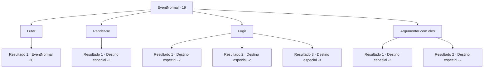

# Eventos normais · 19

[Índice da tabela](index.md) · [Índice geral](../index.md)

ID: `pt:EventNormal:19` · Fonte: `EventNormal4` · Versão: 1.2.47.

Mapeamento estático dos arquivos; a disponibilidade e a execução dependem do estado da run.

## Texto do evento

Você ganhou bastante notoriedade e tem pessoas tremendo de medo.  Você sabe disso porque caçadores de recompensas vieram atrás de você.  

 "Ouça, {1}! Renda-se agora  ou morra uma morte dolorosa e humilhante!"


## Dados de entrada

```json
{
  "id": 19,
  "grade": 1,
  "place": "",
  "required": "2_3_-25|1_2_50"
}
```

## Mapa das escolhas



## Escolhas e resultados

### Escolha 1

Lutar

Requisitos e outros campos da escolha:

```json
{
  "required": ""
}
```

#### Resultado 1.1

Você não tem intenção de ser pego.

Continuação registrada: [Evento 20](0020.md) na mesma tabela.

```json
{
  "required": "",
  "chance": "1",
  "nextEvent": 20,
  "type": 2,
  "reward": "6_0_25",
  "place": 0
}
```

### Escolha 2

Render-se

Requisitos e outros campos da escolha:

```json
{
  "required": ""
}
```

#### Resultado 2.1

Você se rende imediatamente.  

 "Bem, isso foi decepcionante ..."

  Os caçadores de recompensas pareceram desapontados, como se estivessem realmente ansiosos por uma luta.  Eles pegaram seu ouro, amarraram você e o prenderam.

Continuação registrada: [Destino especial `-2`](../destinos-especiais.md).

```json
{
  "required": "",
  "chance": "1",
  "nextEvent": -2,
  "type": 2,
  "reward": "0_3_10|0_4_-100|5_1_1"
}
```

### Escolha 3

Fugir

Requisitos e outros campos da escolha:

```json
{
  "required": ""
}
```

#### Resultado 3.1

Você correu para não ficar sentado ali, esperando ser pego.  Eles não conseguiram alcançá-lo.

Continuação registrada: [Destino especial `-2`](../destinos-especiais.md).

```json
{
  "required": "",
  "chance": "1|0_6_1",
  "nextEvent": -2,
  "type": 0,
  "reward": "0_3_-5|0_2_2"
}
```

#### Resultado 3.2

Você tenta fugir dos caçadores de recompensas, mas falha.  Eles amarram você e o aprisiona.

Continuação registrada: [Destino especial `-2`](../destinos-especiais.md).

```json
{
  "required": "1_1_2",
  "chance": "19",
  "nextEvent": -2,
  "type": 1,
  "reward": "0_1_-1|5_1_1"
}
```

#### Resultado 3.3

Você tenta fugir dos caçadores de recompensas, mas falha.  Você morre da violência excessiva deles.

Continuação registrada: [Destino especial `-3`](../destinos-especiais.md).

```json
{
  "required": "2_1_2",
  "chance": "1",
  "nextEvent": -3,
  "type": 1,
  "reward": "0_1_-1"
}
```

### Escolha 4

Argumentar com eles

Requisitos e outros campos da escolha:

```json
{
  "required": ""
}
```

#### Resultado 4.1

Você tenta convencê-los a não levá-lo.  Mas os caçadores de recompensas não estão lá para ouvir.  Eles amarram você e o aprisiona.

Continuação registrada: [Destino especial `-2`](../destinos-especiais.md).

```json
{
  "required": "",
  "chance": "15",
  "nextEvent": -2,
  "type": 1,
  "reward": "0_1_-1|5_1_1"
}
```

#### Resultado 4.2

Você os hipnotiza com seu charme. Um deles olha para você com olhos lascivos e fala. 

 "Passe uma noite quente comigo e vou pensar em deixar você ir."

 Depois de um momento de silêncio, eles começam a lutar por você. Você sai enquanto eles discutem entre si.

Continuação registrada: [Destino especial `-2`](../destinos-especiais.md).

```json
{
  "required": "11_0_1",
  "chance": "1|0_12_1",
  "nextEvent": -2,
  "type": 0,
  "reward": "0_1_-1|0_2_2"
}
```

## Referências que chegam a este evento

Nenhum `nextEvent` positivo da mesma tabela aponta para este nó. Isso não prova que seja inacessível: sorteio e estado de história podem selecioná-lo.

