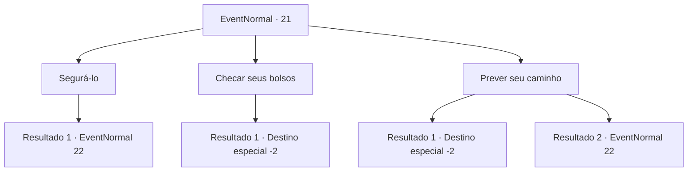

# Eventos normais · 21

[Índice da tabela](index.md) · [Índice geral](../index.md)

ID: `pt:EventNormal:21` · Fonte: `EventNormal4` · Versão: 1.2.47.

Mapeamento estático dos arquivos; a disponibilidade e a execução dependem do estado da run.

## Texto do evento

Você se dirige a uma cidade próxima para descansar um pouco.|drawing_town|O mercado da cidade está aberto e cheio de compradores e vendedores. Uma pessoa passa rapidamente por você.

## Dados de entrada

```json
{
  "id": 21,
  "grade": 1,
  "place": "",
  "required": "5_0_0|1_4_5"
}
```

## Mapa das escolhas



## Escolhas e resultados

### Escolha 1

Segurá-lo

Requisitos e outros campos da escolha:

```json
{
  "required": "1_6_10"
}
```

#### Resultado 1.1

Você o agarra graças aos seus bons reflexos.  Surpreso, ele ergue os olhos e fala.  

 "Eu ... me desculpe! Mas minha família ... eu tenho uma família faminta para alimentar!"

  Ele pede seu perdão.

Continuação registrada: [Evento 22](0022.md) na mesma tabela.

```json
{
  "required": "",
  "chance": "1",
  "nextEvent": 22,
  "type": 2,
  "reward": "0_4_-5"
}
```

### Escolha 2

Checar seus bolsos

Requisitos e outros campos da escolha:

```json
{
  "required": ""
}
```

#### Resultado 2.1

Você verifica seus bolsos e percebe que o dinheiro sumiu.  Você se vira, mas o ladrão se foi.

Continuação registrada: [Destino especial `-2`](../destinos-especiais.md).

```json
{
  "required": "",
  "chance": "10",
  "nextEvent": -2,
  "type": 2,
  "reward": "0_1_-1|0_4_-5|0_2_1"
}
```

### Escolha 3

Prever seu caminho

Requisitos e outros campos da escolha:

```json
{
  "required": "1_14_10"
}
```

#### Resultado 3.1

Você o acha suspeito e verifica seus bolsos. Com certeza, faltam várias moedas.  Você espera por ele perto de ruas pelas quais ele pode passar.  Mas o batedor de carteira não apareceu.

Continuação registrada: [Destino especial `-2`](../destinos-especiais.md).

```json
{
  "required": "",
  "chance": "10",
  "nextEvent": -2,
  "type": 1,
  "reward": "0_1_-1|0_4_-5|0_2_1"
}
```

#### Resultado 3.2

Você o acha suspeito e verifica seus bolsos. Com certeza, faltam várias moedas.  Você espera por ele perto de ruas pelas quais ele pode passar.  Poucos minutos depois, você o vê passar por você.  O sorriso satisfatório do ladrão se transforma em uma expressão de choque quando você o agarra.

Continuação registrada: [Evento 22](0022.md) na mesma tabela.

```json
{
  "required": "",
  "chance": "1|0_7_1",
  "nextEvent": 22,
  "type": 0,
  "reward": ""
}
```

## Referências que chegam a este evento

Nenhum `nextEvent` positivo da mesma tabela aponta para este nó. Isso não prova que seja inacessível: sorteio e estado de história podem selecioná-lo.

