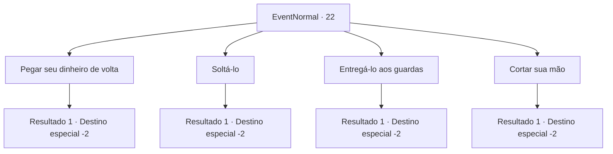

# Eventos normais · 22

[Índice da tabela](index.md) · [Índice geral](../index.md)

ID: `pt:EventNormal:22` · Fonte: `EventNormal4` · Versão: 1.2.47.

Mapeamento estático dos arquivos; a disponibilidade e a execução dependem do estado da run.

## Texto do evento

*Sem texto no arquivo.*

## Dados de entrada

```json
{
  "id": 22,
  "grade": 1,
  "place": "",
  "required": ""
}
```

## Mapa das escolhas



## Escolhas e resultados

### Escolha 1

Pegar seu dinheiro de volta

Requisitos e outros campos da escolha:

```json
{
  "required": ""
}
```

#### Resultado 1.1

Você pede seu dinheiro de volta e ele obedece. Você o solta assim que recupera o dinheiro.

Continuação registrada: [Destino especial `-2`](../destinos-especiais.md).

```json
{
  "required": "",
  "chance": "1",
  "nextEvent": -2,
  "type": 2,
  "reward": "0_4_5|0_2_1"
}
```

### Escolha 2

Soltá-lo

Requisitos e outros campos da escolha:

```json
{
  "required": ""
}
```

#### Resultado 2.1

Você o deixou ir sem perguntar mais nada.  Ele agradece e sai correndo.

Continuação registrada: [Destino especial `-2`](../destinos-especiais.md).

```json
{
  "required": "",
  "chance": "1",
  "nextEvent": -2,
  "type": 2,
  "reward": "0_3_5|0_2_1"
}
```

### Escolha 3

Entregá-lo aos guardas

Requisitos e outros campos da escolha:

```json
{
  "required": ""
}
```

#### Resultado 3.1

Você o amarra com uma corda.  <link=shake>

 "Você ... Você vai me entregar? Por favor! Por favor, não faça isso comigo, por favor !!"

</link>  O batedor de carteiras implora e suplica.  Mas você o entrega à polícia.

Continuação registrada: [Destino especial `-2`](../destinos-especiais.md).

```json
{
  "required": "",
  "chance": "1",
  "nextEvent": -2,
  "type": 2,
  "reward": "0_4_30|0_2_1|5_0_9"
}
```

### Escolha 4

Cortar sua mão

Requisitos e outros campos da escolha:

```json
{
  "required": "2_3_0"
}
```

#### Resultado 4.1

Você corta a mão direita dele para que ele nunca mais roube. <link=shake><color=red>

 "AHHHH !! NÃÃÃOOO!!! AHHHHH!!"

</color></link> O sangue espirra por toda parte quando ele desmaia, e as pessoas gritam e olham fixamente. Você deixa a multidão chocada para trás e continua sua jornada.

Continuação registrada: [Destino especial `-2`](../destinos-especiais.md).

```json
{
  "required": "",
  "chance": "1",
  "nextEvent": -2,
  "type": 2,
  "reward": "0_1_1|0_2_2|5_0_1|0_3_-5"
}
```

## Referências que chegam a este evento

- [Evento 21 · escolha 1 · resultado 1](0021.md#escolha-1)
- [Evento 21 · escolha 3 · resultado 2](0021.md#escolha-3)
