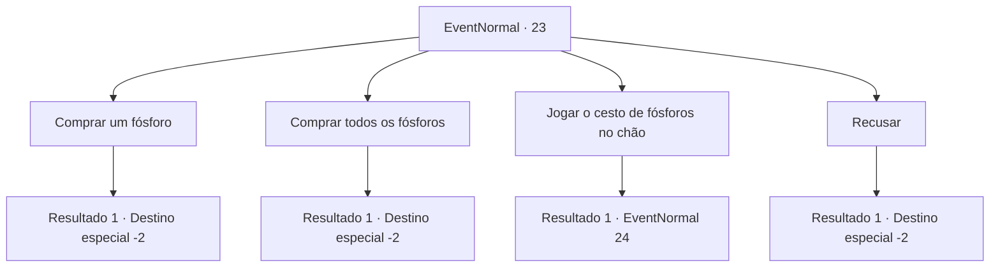

# Eventos normais · 23

[Índice da tabela](index.md) · [Índice geral](../index.md)

ID: `pt:EventNormal:23` · Fonte: `EventNormal4` · Versão: 1.2.47.

Mapeamento estático dos arquivos; a disponibilidade e a execução dependem do estado da run.

## Texto do evento

Você está caminhando em uma nevasca quando você se depara com uma garotinha vendendo fósforos. Ela vai até você sem medo e pergunta. 

 "Você poderia... Você poderia, por favor, comprar apenas um palito de fósforo meu?"


## Dados de entrada

```json
{
  "id": 23,
  "grade": 1,
  "place": "",
  "required": "5_18_0"
}
```

## Mapa das escolhas



## Escolhas e resultados

### Escolha 1

Comprar um fósforo

Requisitos e outros campos da escolha:

```json
{
  "required": "1_4_1"
}
```

#### Resultado 1.1

A garota se curva em gratidão e desaparece.

Continuação registrada: [Destino especial `-2`](../destinos-especiais.md).

```json
{
  "required": "",
  "chance": "1",
  "nextEvent": -2,
  "type": 2,
  "reward": "0_3_1|0_4_-1|3_40_1|0_2_1"
}
```

### Escolha 2

Comprar todos os fósforos

Requisitos e outros campos da escolha:

```json
{
  "required": "1_4_20"
}
```

#### Resultado 2.1

Os olhos da garota se arregalam enquanto ela grita em descrença. 

 "O que?? Por que você..."

 A menina entrega a você seu cesto de fósforos com as mãos trêmulas, e se curva em gratidão, de modo que sua cabeça quase toca o chão. Então ela desaparece.

Continuação registrada: [Destino especial `-2`](../destinos-especiais.md).

```json
{
  "required": "",
  "chance": "1",
  "nextEvent": -2,
  "type": 2,
  "reward": "0_3_5|0_4_-20|3_47_1|3_40_1|5_18_2|0_2_1"
}
```

### Escolha 3

Jogar o cesto de fósforos no chão

Requisitos e outros campos da escolha:

```json
{
  "required": ""
}
```

#### Resultado 3.1

Você joga o cesto de fósforos no chão. A garota cai enquanto os fósforos se espalham pelo chão. <link=shake>

 "Por que ... Por que você ..."

</link> A garota olha para você com os olhos sangrando. A pele dela fica azul enquanto os olhos ficam vermelhos como sangue. Você sente uma raiva forte e fria irradiando do corpo dela.

Continuação registrada: [Evento 24](0024.md) na mesma tabela.

```json
{
  "required": "",
  "chance": "1",
  "nextEvent": 24,
  "type": 2,
  "reward": "0_3_-2|6_0_45",
  "place": 9
}
```

### Escolha 4

Recusar

Requisitos e outros campos da escolha:

```json
{
  "required": ""
}
```

#### Resultado 4.1


 "Tenha um bom dia, então."

 A garota se curva e desaparece.

Continuação registrada: [Destino especial `-2`](../destinos-especiais.md).

```json
{
  "required": "",
  "chance": "1",
  "nextEvent": -2,
  "type": 2,
  "reward": ""
}
```

## Referências que chegam a este evento

Nenhum `nextEvent` positivo da mesma tabela aponta para este nó. Isso não prova que seja inacessível: sorteio e estado de história podem selecioná-lo.

