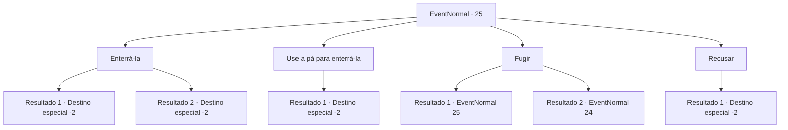

# Eventos normais · 25

[Índice da tabela](index.md) · [Índice geral](../index.md)

ID: `pt:EventNormal:25` · Fonte: `EventNormal4` · Versão: 1.2.47.

Mapeamento estático dos arquivos; a disponibilidade e a execução dependem do estado da run.

## Texto do evento

Você corre para a menina do fósforo novamente. Ela acena alegremente para você e segura sua mão. As mãos dela estão frias como o gelo. 

 "Aventureiro... gostaria de lhe pedir um favor."

 Ela puxa sua mão e você a segue como se estivesse possuído. Depois de um tempo, você encontra um cadáver abandonado. 

 "Por favor, enterre meu corpo. Por favor."


## Dados de entrada

```json
{
  "id": 25,
  "grade": 1,
  "place": "",
  "required": "5_18_2"
}
```

## Mapa das escolhas



## Escolhas e resultados

### Escolha 1

Enterrá-la

Requisitos e outros campos da escolha:

```json
{
  "required": ""
}
```

#### Resultado 1.1

Você tenta cavar com suas próprias mãos, mas o solo está muito congelado para cavar.  Então você decide cremar ela.  Você usa os fósforos que comprou da menina para acender o fogo.  A menina observa o corpo dela queimar enquanto ela fala.  

 "Obrigada. Agora posso sair em paz. Por favor, pegue isso. É meu presente para você."

  Ela oferece uma pequena poção. Você pega e ela vai embora.

Continuação registrada: [Destino especial `-2`](../destinos-especiais.md).

```json
{
  "required": "8_47_1",
  "chance": "1",
  "nextEvent": -2,
  "type": 2,
  "reward": "5_18_3|3_36_1|0_3_5|0_2_2|4_47_1"
}
```

#### Resultado 1.2

Você cava um buraco no solo congelado com suas próprias mãos e enterra o corpo dela.  Parece que suas mãos estão prestes a se quebrar.  

 "Obrigada. Agora posso sair em paz. Por favor, pegue isso. É meu presente para você."


Continuação registrada: [Destino especial `-2`](../destinos-especiais.md).

```json
{
  "required": "10_47_1",
  "chance": "1",
  "nextEvent": -2,
  "type": 2,
  "reward": "5_18_3|3_36_1|0_3_5|0_2_2"
}
```

### Escolha 2

Use a pá para enterrá-la

Requisitos e outros campos da escolha:

```json
{
  "required": "8_38_1"
}
```

#### Resultado 2.1

Você cava um buraco no solo congelado com sua pá e enterra o corpo dela.  O solo é tão duro que quebra o cabo da pá.  

 "Obrigada. Agora posso sair em paz. Por favor, pegue isso. É meu presente para você."


Continuação registrada: [Destino especial `-2`](../destinos-especiais.md).

```json
{
  "required": "",
  "chance": "1",
  "nextEvent": -2,
  "type": 2,
  "reward": "5_18_3|3_36_1|0_3_5|0_2_2|4_38_1"
}
```

### Escolha 3

Fugir

Requisitos e outros campos da escolha:

```json
{
  "required": ""
}
```

#### Resultado 3.1

Você tenta fugir dela.  Você corre e corre, mas acaba bem na frente do corpo da garota.  Ela implora com a voz mais triste que você já ouviu.  

 "Por favor ... Por favor, não fuja."


Continuação registrada: [Evento 25](0025.md) na mesma tabela.

```json
{
  "required": "18_18_4",
  "chance": "1",
  "nextEvent": 25,
  "type": 2,
  "reward": "5_18_4"
}
```

#### Resultado 3.2

Você está encharcado de suor frio.  Mas você ainda tenta correr.  Você corre e corre, mas acaba bem na frente do corpo da garota.  <link=shake><color=red>

 "Eu te disse ... PARA. NÃO. CORRER."

</color></link>  Um arrepio penetrante desce pela sua espinha quando você se vira.  O que o encara de volta não é mais a garota que você conhecia.

Continuação registrada: [Evento 24](0024.md) na mesma tabela.

```json
{
  "required": "5_18_4",
  "chance": "1",
  "nextEvent": 24,
  "type": 2,
  "reward": "6_0_45",
  "place": 9
}
```

### Escolha 4

Recusar

Requisitos e outros campos da escolha:

```json
{
  "required": ""
}
```

#### Resultado 4.1

Você se recusa a enterrá-la.  Ela olha para você com tristeza, antes de desaparecer.

Continuação registrada: [Destino especial `-2`](../destinos-especiais.md).

```json
{
  "required": "",
  "chance": "1",
  "nextEvent": -2,
  "type": 2,
  "reward": "0_3_-1"
}
```

## Referências que chegam a este evento

- [Evento 25 · escolha 3 · resultado 1](0025.md#escolha-3)
