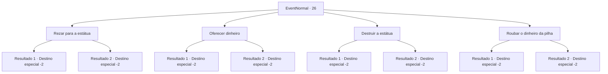

# Eventos normais · 26

[Índice da tabela](index.md) · [Índice geral](../index.md)

ID: `pt:EventNormal:26` · Fonte: `EventNormal4` · Versão: 1.2.47.

Mapeamento estático dos arquivos; a disponibilidade e a execução dependem do estado da run.

## Texto do evento

As pessoas estão orando para uma pequena estátua na estrada. Enquanto você os encara com curiosidade, uma idosa se aproxima de você. 

 "Caso você esteja se perguntando ... Essa estátua foi feita para louvar nosso espírito guardião. Se você orar conosco, o espírito poderá te abençoar também."


## Dados de entrada

```json
{
  "id": 26,
  "grade": 1,
  "place": "",
  "required": "5_13_0"
}
```

## Mapa das escolhas



## Escolhas e resultados

### Escolha 1

Rezar para a estátua

Requisitos e outros campos da escolha:

```json
{
  "required": ""
}
```

#### Resultado 1.1

Você se ajoelha diante da estátua de aparência estranha enquanto suas mãos se encontram em oração.  Você se sente em paz.

Continuação registrada: [Destino especial `-2`](../destinos-especiais.md).

```json
{
  "required": "",
  "chance": "10",
  "nextEvent": -2,
  "type": 1,
  "reward": "0_2_1|0_1_1"
}
```

#### Resultado 1.2

Você se aproxima da estátua de aparência estranha.  Sua visão aguçado diz que ela está inserida em um círculo de magia exclusivamente estruturado.  Você concentra sua mente ao tocar a estátua, e os poderes dela fluem para você.

Continuação registrada: [Destino especial `-2`](../destinos-especiais.md).

```json
{
  "required": "",
  "chance": "1|0_7_1",
  "nextEvent": -2,
  "type": 0,
  "reward": "0_7_1|0_2_1"
}
```

### Escolha 2

Oferecer dinheiro

Requisitos e outros campos da escolha:

```json
{
  "required": "1_4_1"
}
```

#### Resultado 2.1

Você coloca 1 ouro perto da estátua.  Não acontece muita coisa.

Continuação registrada: [Destino especial `-2`](../destinos-especiais.md).

```json
{
  "required": "",
  "chance": "1",
  "nextEvent": -2,
  "type": 2,
  "reward": "0_4_-1|0_2_1"
}
```

#### Resultado 2.2

Você coloca 1 ouro perto da estátua.  Você se sente em paz.

Continuação registrada: [Destino especial `-2`](../destinos-especiais.md).

```json
{
  "required": "",
  "chance": "1",
  "nextEvent": -2,
  "type": 2,
  "reward": "0_2_1|0_1_1|0_4_-1"
}
```

### Escolha 3

Destruir a estátua

Requisitos e outros campos da escolha:

```json
{
  "required": ""
}
```

#### Resultado 3.1

Você golpeia a estátua com todas as suas forças.  Nem um arranhão. A multidão assustada olha para você.  Você se sente envergonhado e sai rapidamente do local.

Continuação registrada: [Destino especial `-2`](../destinos-especiais.md).

```json
{
  "required": "",
  "chance": "4",
  "nextEvent": -2,
  "type": 1,
  "reward": "0_2_1"
}
```

#### Resultado 3.2

Você golpeia a estátua com todas as suas forças.  A estátua se quebra em pedaços e a magia dela flui para dentro de você.  A multidão assustada olha para você.  Você se sente envergonhado e sai rapidamente do local.

Continuação registrada: [Destino especial `-2`](../destinos-especiais.md).

```json
{
  "required": "",
  "chance": "1|0_5_1",
  "nextEvent": -2,
  "type": 0,
  "reward": "0_5_1|0_2_1|5_13_1"
}
```

### Escolha 4

Roubar o dinheiro da pilha

Requisitos e outros campos da escolha:

```json
{
  "required": ""
}
```

#### Resultado 4.1

Você tenta roubar da pilha de dinheiro que as pessoas ofereceram para a estátua.  Você falha porque a multidão olha para você.  Você se sente envergonhado e sai rapidamente do local.

Continuação registrada: [Destino especial `-2`](../destinos-especiais.md).

```json
{
  "required": "",
  "chance": "11",
  "nextEvent": -2,
  "type": 1,
  "reward": ""
}
```

#### Resultado 4.2

Você consegue roubar a pilha de dinheiro que as pessoas ofereceram à estátua. Então você sai como se nunca tivesse estado lá.

Continuação registrada: [Destino especial `-2`](../destinos-especiais.md).

```json
{
  "required": "",
  "chance": "1|0_6_1",
  "nextEvent": -2,
  "type": 0,
  "reward": "0_2_1|0_4_5|5_13_1|0_6_1|0_3_-1"
}
```

## Referências que chegam a este evento

Nenhum `nextEvent` positivo da mesma tabela aponta para este nó. Isso não prova que seja inacessível: sorteio e estado de história podem selecioná-lo.

