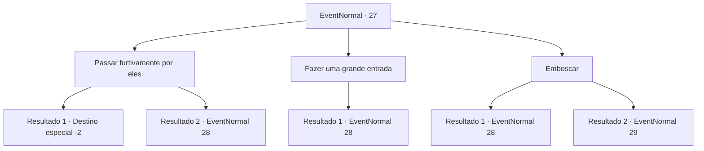

# Eventos normais · 27

[Índice da tabela](index.md) · [Índice geral](../index.md)

ID: `pt:EventNormal:27` · Fonte: `EventNormal4` · Versão: 1.2.47.

Mapeamento estático dos arquivos; a disponibilidade e a execução dependem do estado da run.

## Texto do evento

Você ouve pessoas conversando na escuridão sem lua.  Você se aproxima com cuidado e descobre que eles são caçadores de recompensas.  Eles estão conversando entre si em uma tenda.

## Dados de entrada

```json
{
  "id": 27,
  "grade": 1,
  "place": "",
  "required": "5_11_1"
}
```

## Mapa das escolhas



## Escolhas e resultados

### Escolha 1

Passar furtivamente por eles

Requisitos e outros campos da escolha:

```json
{
  "required": ""
}
```

#### Resultado 1.1

Você os deixa em paz e passa furtivamente pela tenda.  Eles não notam você.

Continuação registrada: [Destino especial `-2`](../destinos-especiais.md).

```json
{
  "required": "",
  "chance": "1|0_6_1",
  "nextEvent": -2,
  "type": 0,
  "reward": "0_2_1"
}
```

#### Resultado 1.2

Você tenta passar furtivamente por eles, mas os caçadores de recompensas vêem você.  Eles o reconhecem imediatamente.

Continuação registrada: [Evento 28](0028.md) na mesma tabela.

```json
{
  "required": "",
  "chance": "5",
  "nextEvent": 28,
  "type": 1,
  "reward": "6_0_25",
  "place": 14
}
```

### Escolha 2

Fazer uma grande entrada

Requisitos e outros campos da escolha:

```json
{
  "required": ""
}
```

#### Resultado 2.1

Você faz uma grande entrada no acampamento dos caçadores de recompensas.  Eles o reconhecem imediatamente.

Continuação registrada: [Evento 28](0028.md) na mesma tabela.

```json
{
  "required": "",
  "chance": "1",
  "nextEvent": 28,
  "type": 2,
  "reward": "6_0_25",
  "place": 14
}
```

### Escolha 3

Emboscar

Requisitos e outros campos da escolha:

```json
{
  "required": ""
}
```

#### Resultado 3.1

Você tenta emboscá-los, mas falha.

Continuação registrada: [Evento 28](0028.md) na mesma tabela.

```json
{
  "required": "",
  "chance": "10",
  "nextEvent": 28,
  "type": 1,
  "reward": "6_3_25",
  "place": 14
}
```

#### Resultado 3.2

Sua emboscada é um sucesso. Você imediatamente mata um deles,  e os outros se levantam surpresos.

Continuação registrada: [Evento 29](0029.md) na mesma tabela.

```json
{
  "required": "",
  "chance": "1|0_6_1",
  "nextEvent": 29,
  "type": 0,
  "reward": "6_2_25",
  "place": 14
}
```

## Referências que chegam a este evento

Nenhum `nextEvent` positivo da mesma tabela aponta para este nó. Isso não prova que seja inacessível: sorteio e estado de história podem selecioná-lo.

