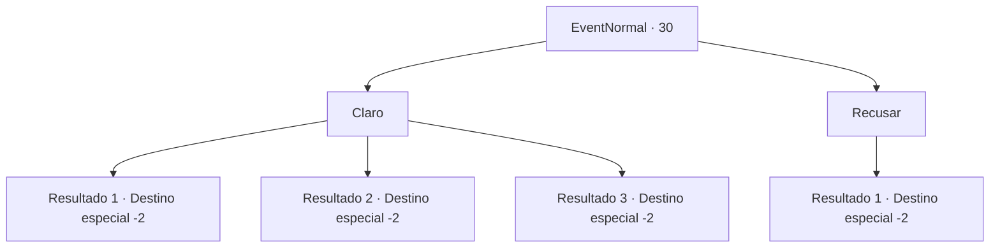

# Eventos normais · 30

[Índice da tabela](index.md) · [Índice geral](../index.md)

ID: `pt:EventNormal:30` · Fonte: `EventNormal4` · Versão: 1.2.47.

Mapeamento estático dos arquivos; a disponibilidade e a execução dependem do estado da run.

## Texto do evento

Uma criança puxa a manga de sua camisa. Ela fala com a boca cheia. 

 "He-oh aventu-rero ... Ocê tem gumas gemas?"

 Você vê joias quebradas cintilando por entre os dentes dela. Ela engole e continua. 

 "Estou morrendo de fome, bom aventureiro. Ficarei feliz em trocar meus itens úteis por algumas joias!"


## Dados de entrada

```json
{
  "id": 30,
  "grade": 1,
  "place": "",
  "required": "5_626_0"
}
```

## Mapa das escolhas



## Escolhas e resultados

### Escolha 1

Claro

Requisitos e outros campos da escolha:

```json
{
  "required": "17_0_1"
}
```

#### Resultado 1.1

Ela agradece com um grande sorriso.  Então ela lhe dá uma poção.  

 "Eu espero que isso ajude! Até a próxima!"

  Ela se afasta, mastigando algumas joias.

Continuação registrada: [Destino especial `-2`](../destinos-especiais.md).

```json
{
  "required": "",
  "chance": "1",
  "nextEvent": -2,
  "type": 2,
  "reward": "0_2_1|3_36_1|3_37_1|5_626_1"
}
```

#### Resultado 1.2

Ela agradece com um grande sorriso.  Então ela lhe entrega uma orbe vermelha.  

 "Eu espero que isso ajude! Até a próxima!"

  Ela se afasta, mastigando algumas joias.

Continuação registrada: [Destino especial `-2`](../destinos-especiais.md).

```json
{
  "required": "2_2_-100",
  "chance": "1",
  "nextEvent": -2,
  "type": 2,
  "reward": "0_2_1|3_45_1|5_626_1"
}
```

#### Resultado 1.3

Ela agradece com um grande sorriso.  Então ela lhe dá uma poção.  

 "Eu espero que isso ajude! Até a próxima!"

  Ela se afasta, mastigando algumas joias.

Continuação registrada: [Destino especial `-2`](../destinos-especiais.md).

```json
{
  "required": "2_2_-100",
  "chance": "1",
  "nextEvent": -2,
  "type": 2,
  "reward": "0_2_1|3_52_1|5_626_1"
}
```

### Escolha 2

Recusar

Requisitos e outros campos da escolha:

```json
{
  "required": ""
}
```

#### Resultado 2.1


 "Tudo bem."

  Ela sai parecendo desapontada.

Continuação registrada: [Destino especial `-2`](../destinos-especiais.md).

```json
{
  "required": "",
  "chance": "1",
  "nextEvent": -2,
  "type": 2,
  "reward": ""
}
```

## Referências que chegam a este evento

Nenhum `nextEvent` positivo da mesma tabela aponta para este nó. Isso não prova que seja inacessível: sorteio e estado de história podem selecioná-lo.

