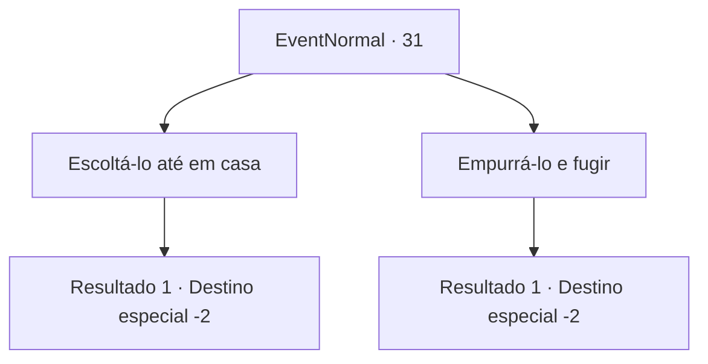

# Eventos normais · 31

[Índice da tabela](index.md) · [Índice geral](../index.md)

ID: `pt:EventNormal:31` · Fonte: `EventNormal4` · Versão: 1.2.47.

Mapeamento estático dos arquivos; a disponibilidade e a execução dependem do estado da run.

## Texto do evento

Um homem assustado corre em sua direção, em uma floresta escura e sombria. Ele parece ter visto um fantasma. Pálido, ele agarra seu braço e gagueja enquanto fala. Pelo que você pode perceber, ele e seus amigos estavam acampando quando um fantasma veio e os atacou com uma espada. 

 "Ele poderia ter me matado! Eu... eu simplesmente sei que poderia. Me acompanhe até o fim..! Por favor, me leve para casa!"


## Dados de entrada

```json
{
  "id": 31,
  "grade": 1,
  "place": "",
  "required": "5_20_0"
}
```

## Mapa das escolhas



## Escolhas e resultados

### Escolha 1

Escoltá-lo até em casa

Requisitos e outros campos da escolha:

```json
{
  "required": ""
}
```

#### Resultado 1.1

Você conforta o homem que chora ao levá-lo de volta para casa dele.  Ele parece se acalmar um pouco.  Então ele pede mais um favor.  

 "Vou pagar a você 200 de ouro para se livrar daquele demônio. Juro pelo meu nome, 'Pastov'."

  Você acena com a cabeça e sai da casa dele.

Continuação registrada: [Destino especial `-2`](../destinos-especiais.md).

```json
{
  "required": "",
  "chance": "1",
  "nextEvent": -2,
  "type": 2,
  "reward": "0_4_1|5_20_1|0_2_2"
}
```

### Escolha 2

Empurrá-lo e fugir

Requisitos e outros campos da escolha:

```json
{
  "required": ""
}
```

#### Resultado 2.1

Você o empurra. <link=shake>

 "Por favor !! Por favor, não me deixe !!! Seu desgraçado de coração frio!!!"

</link> Ignorando os gritos dele, você corre até ele te perder de vista.

Continuação registrada: [Destino especial `-2`](../destinos-especiais.md).

```json
{
  "required": "",
  "chance": "1",
  "nextEvent": -2,
  "type": 2,
  "reward": "0_3_-1|0_2_1|5_20_9"
}
```

## Referências que chegam a este evento

Nenhum `nextEvent` positivo da mesma tabela aponta para este nó. Isso não prova que seja inacessível: sorteio e estado de história podem selecioná-lo.

