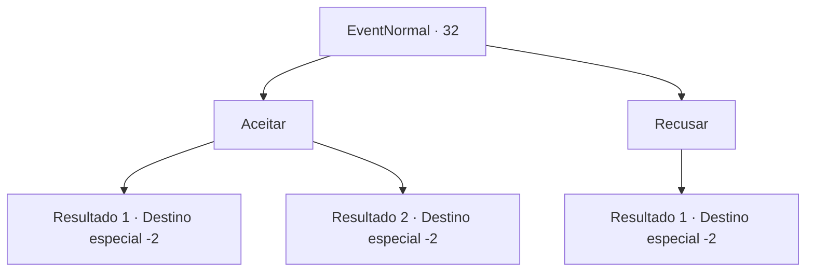

# Eventos normais · 32

[Índice da tabela](index.md) · [Índice geral](../index.md)

ID: `pt:EventNormal:32` · Fonte: `EventNormal4` · Versão: 1.2.47.

Mapeamento estático dos arquivos; a disponibilidade e a execução dependem do estado da run.

## Texto do evento

Você passa por uma loja de bebidas na cidade. Você está mastigando carne seca de veado e saboreando uma cerveja gelada, quando um homem musculoso se aproxima de você. 

 "Que tal uma aposta. 10 ouros pra ver quem é melhor na queda de braço. O que você me diz?"


## Dados de entrada

```json
{
  "id": 32,
  "grade": 1,
  "place": "",
  "required": ""
}
```

## Mapa das escolhas



## Escolhas e resultados

### Escolha 1

Aceitar

Requisitos e outros campos da escolha:

```json
{
  "required": "1_4_10"
}
```

#### Resultado 1.1

Você luta queda de braços contra ele. Mas logo você cede e ele vence.  O homem ri alto.  

 "Hahahaha! Malhe um pouco antes de se considerar um aventureiro, amigo!"

  Ele dá um tapinha em seu ombro e sai.

Continuação registrada: [Destino especial `-2`](../destinos-especiais.md).

```json
{
  "required": "",
  "chance": "10",
  "nextEvent": -2,
  "type": 1,
  "reward": "0_4_-10|0_2_1"
}
```

#### Resultado 1.2

Você vira o braço dele e vence.  Ele coça a cabeça e lhe entrega o ouro.  

 "Você é mais forte do que parece."

  Ele sai em busca de outro competidor.

Continuação registrada: [Destino especial `-2`](../destinos-especiais.md).

```json
{
  "required": "",
  "chance": "1|0_5_1",
  "nextEvent": -2,
  "type": 0,
  "reward": "0_4_10|0_2_1"
}
```

### Escolha 2

Recusar

Requisitos e outros campos da escolha:

```json
{
  "required": ""
}
```

#### Resultado 2.1

O homem rosna e vai embora.

Continuação registrada: [Destino especial `-2`](../destinos-especiais.md).

```json
{
  "required": "",
  "chance": "1",
  "nextEvent": -2,
  "type": 2,
  "reward": ""
}
```

## Referências que chegam a este evento

Nenhum `nextEvent` positivo da mesma tabela aponta para este nó. Isso não prova que seja inacessível: sorteio e estado de história podem selecioná-lo.

