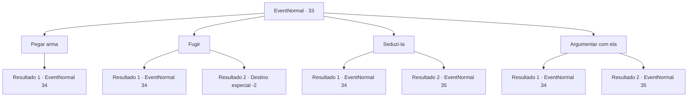

# Eventos normais · 33

[Índice da tabela](index.md) · [Índice geral](../index.md)

ID: `pt:EventNormal:33` · Fonte: `EventNormal4` · Versão: 1.2.47.

Mapeamento estático dos arquivos; a disponibilidade e a execução dependem do estado da run.

## Texto do evento

Você segue para o local onde Pastov afirma ter visto o demônio.  Você encontra um corpo sem cabeça lá.  Os órgãos genitais também estão gravemente danificados.  Só então, você sente que alguém está olhando para você.  Você olha para cima, percebendo que algo está errado.  |drawing_ghost|Uma mulher em trapos está flutuando na sua frente.

## Dados de entrada

```json
{
  "id": 33,
  "grade": 2,
  "place": "",
  "required": "5_20_1"
}
```

## Mapa das escolhas



## Escolhas e resultados

### Escolha 1

Pegar arma

Requisitos e outros campos da escolha:

```json
{
  "required": ""
}
```

#### Resultado 1.1

Você instintivamente pega sua arma.  A mulher grita e aponta uma adaga para você.  <link=shake>

 "Então você está com eles!!"

</link>

Continuação registrada: [Evento 34](0034.md) na mesma tabela.

```json
{
  "required": "",
  "chance": "1",
  "nextEvent": 34,
  "type": 2,
  "reward": "6_0_14",
  "place": 1
}
```

### Escolha 2

Fugir

Requisitos e outros campos da escolha:

```json
{
  "required": ""
}
```

#### Resultado 2.1

Você corre o mais rápido que pode, mas não consegue escapar.  <link=shake>

 "Morra! Morra morra morra!!"

</link>  A mulher grita e aponta uma adaga para você.

Continuação registrada: [Evento 34](0034.md) na mesma tabela.

```json
{
  "required": "",
  "chance": "20",
  "nextEvent": 34,
  "type": 1,
  "reward": "6_3_14",
  "place": 1
}
```

#### Resultado 2.2

Você corre como se sua vida dependesse disso, porque provavelmente depende.  Você conseguiu escapar da mulher.

Continuação registrada: [Destino especial `-2`](../destinos-especiais.md).

```json
{
  "required": "",
  "chance": "1|0_6_1",
  "nextEvent": -2,
  "type": 0,
  "reward": "0_1_-1|0_2_1|5_20_9"
}
```

### Escolha 3

Seduzi-la

Requisitos e outros campos da escolha:

```json
{
  "required": ""
}
```

#### Resultado 3.1

Você tenta seduzi-la.  

  <color=red>Totalmente ineficaz!</color>  

  Agora ela parece genuinamente ofendida.  Ela pega uma adaga.

Continuação registrada: [Evento 34](0034.md) na mesma tabela.

```json
{
  "required": "",
  "chance": "13",
  "nextEvent": 34,
  "type": 1,
  "reward": "6_3_14",
  "place": 1
}
```

#### Resultado 3.2

Você a seduz com seu charme.  Ela olha para você e sorri um pouco.  Então ela limpa a garganta e fala o mais baixo que pode.  

 "... Você ajudou ele, então me ajude também."


Continuação registrada: [Evento 35](0035.md) na mesma tabela.

```json
{
  "required": "",
  "chance": "1|0_12_1",
  "nextEvent": 35,
  "type": 0,
  "reward": "0_2_1"
}
```

### Escolha 4

Argumentar com ela

Requisitos e outros campos da escolha:

```json
{
  "required": ""
}
```

#### Resultado 4.1

Você tenta manter a calma, mas não consegue superar o medo.  Você foge da mulher, e ela o persegue, gritando, com uma adaga.

Continuação registrada: [Evento 34](0034.md) na mesma tabela.

```json
{
  "required": "",
  "chance": "10",
  "nextEvent": 34,
  "type": 1,
  "reward": "6_3_14",
  "place": 1
}
```

#### Resultado 4.2

Você consegue argumentar com ela graças ao seu comportamento calmo.  Ela fala com você com uma voz crepitante.  

 "... Você ajudou ele, então me ajude também."


Continuação registrada: [Evento 35](0035.md) na mesma tabela.

```json
{
  "required": "",
  "chance": "1|0_14_1",
  "nextEvent": 35,
  "type": 0,
  "reward": "0_2_1"
}
```

## Referências que chegam a este evento

Nenhum `nextEvent` positivo da mesma tabela aponta para este nó. Isso não prova que seja inacessível: sorteio e estado de história podem selecioná-lo.

