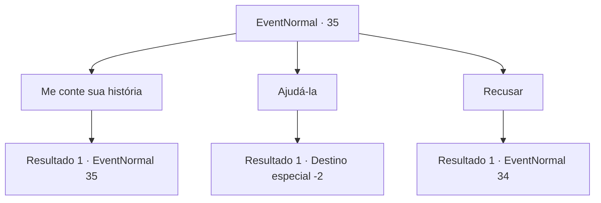

# Eventos normais · 35

[Índice da tabela](index.md) · [Índice geral](../index.md)

ID: `pt:EventNormal:35` · Fonte: `EventNormal4` · Versão: 1.2.47.

Mapeamento estático dos arquivos; a disponibilidade e a execução dependem do estado da run.

## Texto do evento

*Sem texto no arquivo.*

## Dados de entrada

```json
{
  "id": 35,
  "grade": 1,
  "place": "",
  "required": ""
}
```

## Mapa das escolhas



## Escolhas e resultados

### Escolha 1

Me conte sua história

Requisitos e outros campos da escolha:

```json
{
  "required": "5_20_1"
}
```

#### Resultado 1.1

A mulher começa a lhe contar a história dela. 

 "Sim. Eu ... eu morri há mais de uma década. Eu estava procurando ervas nas montanhas. Então ... eu me deparei com eles. Eles me bateram e me arrastaram para algum lugar assim que me viram. No começo, eu estava com muito medo de resistir. Mas eu tentei escapar uma vez que me lembrei da adaga escondida em meu bolso."

 O suspiro frio dela coloriu o ar de branco. 

 "Não deu muito certo, como você pode ver ... Eu esfaqueei um deles com a adaga enquanto tentavam subir em cima de mim. Então eu corri. Achei que seria capaz de escapar. Mas no final, eles me pegaram ..."

 Ela parou um pouco antes de continuar. 

 "Eles me mataram lenta e dolorosamente. Então eles jogaram meu corpo aqui. Eu estava ... amarrada a este lugar, esperando. Esperando por vingança."


Continuação registrada: [Evento 35](0035.md) na mesma tabela.

```json
{
  "required": "",
  "chance": "1",
  "nextEvent": 35,
  "type": 2,
  "reward": "5_20_4"
}
```

### Escolha 2

Ajudá-la

Requisitos e outros campos da escolha:

```json
{
  "required": ""
}
```

#### Resultado 2.1

Você decide ajudar a mulher.  Ela acena com a cabeça e desaparece.

Continuação registrada: [Destino especial `-2`](../destinos-especiais.md).

```json
{
  "required": "",
  "chance": "1",
  "nextEvent": -2,
  "type": 2,
  "reward": "0_3_5|5_20_3|0_2_1"
}
```

### Escolha 3

Recusar

Requisitos e outros campos da escolha:

```json
{
  "required": ""
}
```

#### Resultado 3.1

Você se recusa a ajudar a mulher. O rosto dela se contorce de raiva enquanto ela fala. <color=red>

 "Então você, você é um deles."

</color> Ela saca uma adaga e a aponta para você.

Continuação registrada: [Evento 34](0034.md) na mesma tabela.

```json
{
  "required": "",
  "chance": "1",
  "nextEvent": 34,
  "type": 2,
  "reward": "6_0_14",
  "place": 1
}
```

## Referências que chegam a este evento

- [Evento 33 · escolha 3 · resultado 2](0033.md#escolha-3)
- [Evento 33 · escolha 4 · resultado 2](0033.md#escolha-4)
- [Evento 35 · escolha 1 · resultado 1](0035.md#escolha-1)
