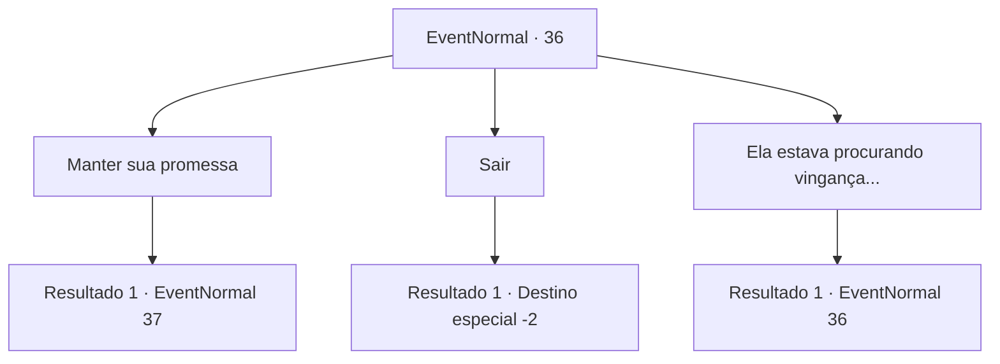

# Eventos normais · 36

[Índice da tabela](index.md) · [Índice geral](../index.md)

ID: `pt:EventNormal:36` · Fonte: `EventNormal4` · Versão: 1.2.47.

Mapeamento estático dos arquivos; a disponibilidade e a execução dependem do estado da run.

## Texto do evento

Você a derrota e leva a adaga para Pastov. Ele examina a adaga com cuidado. 

 "Sim... eu já vi isso antes. Pertencia a aquela menina chamada Maria."

 Ele tira uma pequena bolsa de couro e entrega para você. O dinheiro dificilmente é o que ele havia prometido.

## Dados de entrada

```json
{
  "id": 36,
  "grade": 2,
  "place": "",
  "required": "5_20_2|8_68_1"
}
```

## Mapa das escolhas



## Escolhas e resultados

### Escolha 1

Manter sua promessa

Requisitos e outros campos da escolha:

```json
{
  "required": ""
}
```

#### Resultado 1.1

Você pede a ele para pagar o que prometeu,  e ele lhe dá um olhar visivelmente irritado.  

 "Estou vendendo o almoço para comprar a janta, amigo ... Isso é mesmo necessário?"

  Ele lhe entrega outra bolsa.  

 "... Isso era para ser o dinheiro do aniversário da minha filha.  Mas ... Tudo bem."


Continuação registrada: [Evento 37](0037.md) na mesma tabela.

```json
{
  "required": "",
  "chance": "1",
  "nextEvent": 37,
  "type": 2,
  "reward": "4_48_1"
}
```

### Escolha 2

Sair

Requisitos e outros campos da escolha:

```json
{
  "required": ""
}
```

#### Resultado 2.1

Você diz adeus e o deixa.

Continuação registrada: [Destino especial `-2`](../destinos-especiais.md).

```json
{
  "required": "",
  "chance": "1",
  "nextEvent": -2,
  "type": 2,
  "reward": "0_4_50|4_48_1|0_2_1"
}
```

### Escolha 3

Ela estava procurando vingança...

Requisitos e outros campos da escolha:

```json
{
  "required": "5_121_0"
}
```

#### Resultado 3.1

Ele nega veementemente.  

 "Não, não ... eu não fiz nada para evocar tal raiva.  A única coisa que fiz de errado foi topar com aquela mulher maluca."


Continuação registrada: [Evento 36](0036.md) na mesma tabela.

```json
{
  "required": "",
  "chance": "1",
  "nextEvent": 36,
  "type": 2,
  "reward": "5_121_1"
}
```

## Referências que chegam a este evento

- [Evento 36 · escolha 3 · resultado 1](0036.md#escolha-3)
