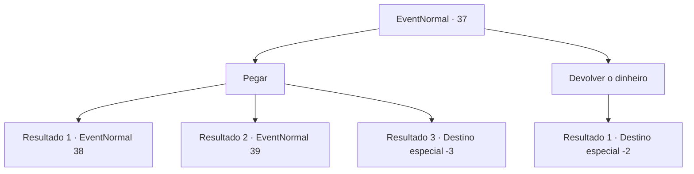

# Eventos normais · 37

[Índice da tabela](index.md) · [Índice geral](../index.md)

ID: `pt:EventNormal:37` · Fonte: `EventNormal4` · Versão: 1.2.47.

Mapeamento estático dos arquivos; a disponibilidade e a execução dependem do estado da run.

## Texto do evento

*Sem texto no arquivo.*

## Dados de entrada

```json
{
  "id": 37,
  "grade": 1,
  "place": "",
  "required": ""
}
```

## Mapa das escolhas



## Escolhas e resultados

### Escolha 1

Pegar

Requisitos e outros campos da escolha:

```json
{
  "required": ""
}
```

#### Resultado 1.1

Você pega todo o dinheiro, incluindo o dinheiro do aniversário da filha de Pastov.  Você diz adeus e se vira para sair.  De repente, sua cabeça dói como se tivesse sido atingida por um raio e você desmaia.

Continuação registrada: [Evento 38](0038.md) na mesma tabela.

```json
{
  "required": "1_0_2",
  "chance": "10",
  "nextEvent": 38,
  "type": 1,
  "reward": "0_0_-1"
}
```

#### Resultado 1.2

Você pega todo o dinheiro, incluindo o dinheiro do aniversário da filha de Pastov. Você diz adeus e se vira para sair. De repente, seus sentidos lhe dizem que algo está errado. Você rola bem a tempo de se esquivar de um golpe na cabeça. 

 "Maldito patife ... eu estava tão perto ..."

 Pastov vem até você com uma clava.

Continuação registrada: [Evento 39](0039.md) na mesma tabela.

```json
{
  "required": "",
  "chance": "1|0_14_1",
  "nextEvent": 39,
  "type": 0,
  "reward": "6_0_2",
  "place": 1
}
```

#### Resultado 1.3

Você pega todo o dinheiro, incluindo o dinheiro do aniversário da filha de Pastov. Você diz adeus e se vira para sair. De repente, parece que sua cabeça foi atingida por um raio e você desmaia.

Continuação registrada: [Destino especial `-3`](../destinos-especiais.md).

```json
{
  "required": "2_0_2",
  "chance": "10",
  "nextEvent": -3,
  "type": 1,
  "reward": "0_0_-1"
}
```

### Escolha 2

Devolver o dinheiro

Requisitos e outros campos da escolha:

```json
{
  "required": ""
}
```

#### Resultado 2.1

Você devolve o dinheiro para ele.  

 "Obrigado pela compreensão. Adeus."

  Você sai da casa dele e segue em frente.

Continuação registrada: [Destino especial `-2`](../destinos-especiais.md).

```json
{
  "required": "",
  "chance": "1",
  "nextEvent": -2,
  "type": 2,
  "reward": "0_3_1|0_4_50|5_20_4|0_2_1"
}
```

## Referências que chegam a este evento

- [Evento 36 · escolha 1 · resultado 1](0036.md#escolha-1)
