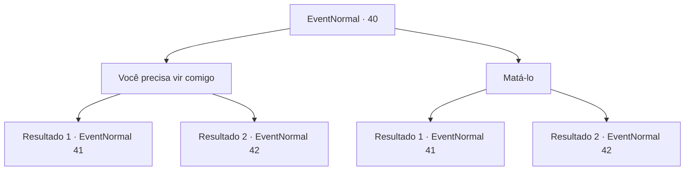

# Eventos normais · 40

[Índice da tabela](index.md) · [Índice geral](../index.md)

ID: `pt:EventNormal:40` · Fonte: `EventNormal4` · Versão: 1.2.47.

Mapeamento estático dos arquivos; a disponibilidade e a execução dependem do estado da run.

## Texto do evento

Você volta para Pastov em nome da mulher morta. Ele está cortando lenha com seu machado. Ele o cumprimenta alegremente, perguntando se você cuidou da fantasma. 

## Dados de entrada

```json
{
  "id": 40,
  "grade": 1,
  "place": "",
  "required": "5_20_3"
}
```

## Mapa das escolhas



## Escolhas e resultados

### Escolha 1

Você precisa vir comigo

Requisitos e outros campos da escolha:

```json
{
  "required": ""
}
```

#### Resultado 1.1

Você diz que ele precisa ir com você. Ele pergunta por que, e você não consegue pensar em uma boa desculpa. Você continua insistindo que ele deve ir, até que ele pega o machado. 

 "Você ... Você está possuído."


Continuação registrada: [Evento 41](0041.md) na mesma tabela.

```json
{
  "required": "",
  "chance": "10",
  "nextEvent": 41,
  "type": 1,
  "reward": "6_0_2",
  "place": 1
}
```

#### Resultado 1.2

Você diz que ele precisa ir com você. Ele pergunta por que, e você inventa uma desculpa convincente. 

 Alguns momentos depois, você o leva até onde conheceu a mulher. Um arrepio penetrante desce pela sua espinha. Então ela aparece do nada. <link=shake>

 "AHHHH !! É ... é a fantasma! Por que ... Por que você está fazendo isso comigo!"

</link> A mulher passa flutuando por você e se aproxima lentamente de Pastov. <link=shake><color=red> 

 "HAHAHAHAHAHA !!! Eu ia te perguntar a mesma coisa. Por que VOCÊ fez isso comigo? Eu disse para você parar, EU IMPLOREI!"

</color></link> Ela abate ele, literalmente, e ele fica reduzido a fatias de carne.  A mulher se curva em agradecimento. Ela lhe entrega a adaga. 

 "Por favor, queime isso para mim. Ou você pode ... ficar com ela."


Continuação registrada: [Evento 42](0042.md) na mesma tabela.

```json
{
  "required": "",
  "chance": "1|0_7_1",
  "nextEvent": 42,
  "type": 0,
  "reward": "3_48_1|5_20_4"
}
```

### Escolha 2

Matá-lo

Requisitos e outros campos da escolha:

```json
{
  "required": ""
}
```

#### Resultado 2.1

Você decide matá-lo.  Ele percebe e pega o machado.  

 "Você ... Você está possuído."


Continuação registrada: [Evento 41](0041.md) na mesma tabela.

```json
{
  "required": "",
  "chance": "12",
  "nextEvent": 41,
  "type": 1,
  "reward": "6_0_2",
  "place": 1
}
```

#### Resultado 2.2

Você decide matá-lo e ele não percebe.  Você caminha até ele, sorrindo, e bate na cabeça dele.  Ele grita e morre instantaneamente.  A mulher olha para o cadáver dele enquanto fala.  

 "Eu teria preferido fazer isso sozinha, mas ... Obrigado."

  Ela lhe entrega a adaga.  

 "Por favor, queime isso para mim. Ou você pode ... ficar com ela."


Continuação registrada: [Evento 42](0042.md) na mesma tabela.

```json
{
  "required": "",
  "chance": "1|0_12_1",
  "nextEvent": 42,
  "type": 0,
  "reward": "0_3_-2|3_48_1|5_20_4"
}
```

## Referências que chegam a este evento

Nenhum `nextEvent` positivo da mesma tabela aponta para este nó. Isso não prova que seja inacessível: sorteio e estado de história podem selecioná-lo.

