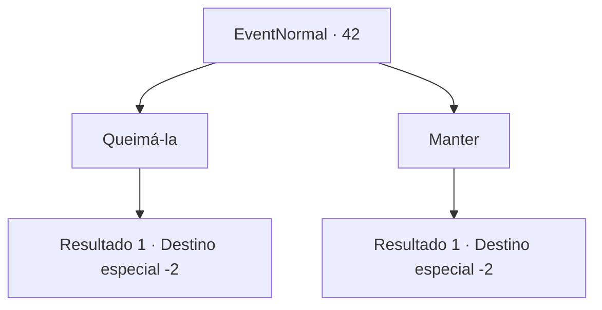

# Eventos normais · 42

[Índice da tabela](index.md) · [Índice geral](../index.md)

ID: `pt:EventNormal:42` · Fonte: `EventNormal4` · Versão: 1.2.47.

Mapeamento estático dos arquivos; a disponibilidade e a execução dependem do estado da run.

## Texto do evento

*Sem texto no arquivo.*

## Dados de entrada

```json
{
  "id": 42,
  "grade": 1,
  "place": "",
  "required": ""
}
```

## Mapa das escolhas



## Escolhas e resultados

### Escolha 1

Queimá-la

Requisitos e outros campos da escolha:

```json
{
  "required": ""
}
```

#### Resultado 1.1

Você recolhe alguns galhos e acende uma fogueira. Então você joga a adaga, como ela pediu. O fogo brilha verde enquanto consome a adaga. Você se sente revigorado ao continuar sua jornada.

Continuação registrada: [Destino especial `-2`](../destinos-especiais.md).

```json
{
  "required": "",
  "chance": "1",
  "nextEvent": -2,
  "type": 2,
  "reward": "0_3_5|0_7_1|4_48_1|0_2_1|5_20_4"
}
```

### Escolha 2

Manter

Requisitos e outros campos da escolha:

```json
{
  "required": ""
}
```

#### Resultado 2.1

A adaga da mulher parece diferente em comparação com suas outras armas.  Você decide mantê-la.  Você embala a lâmina fria em sua bolsa e continua sua jornada.

Continuação registrada: [Destino especial `-2`](../destinos-especiais.md).

```json
{
  "required": "",
  "chance": "1",
  "nextEvent": -2,
  "type": 2,
  "reward": "0_2_1|5_20_4"
}
```

## Referências que chegam a este evento

- [Evento 40 · escolha 1 · resultado 2](0040.md#escolha-1)
- [Evento 40 · escolha 2 · resultado 2](0040.md#escolha-2)
- [Evento 41 · escolha 1 · resultado 1](0041.md#escolha-1)
