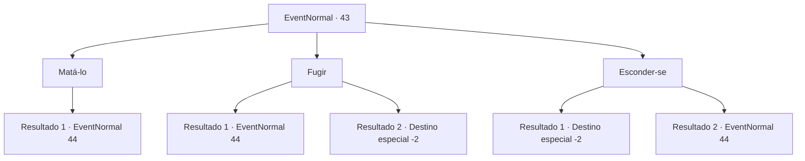

# Eventos normais · 43

[Índice da tabela](index.md) · [Índice geral](../index.md)

ID: `pt:EventNormal:43` · Fonte: `EventNormal4` · Versão: 1.2.47.

Mapeamento estático dos arquivos; a disponibilidade e a execução dependem do estado da run.

## Texto do evento

Você está caminhando por uma floresta densa e mal iluminada. 
<link=shake>CRACKLE CREEK CRAAAAACK---</link>
 De repente, você ouve galhos estalando. Você se vira em direção ao som para encontrar um slime do tamanho de uma pequena casa. Ele já se alimentou bem, a julgar pelos muitos ossos de animais e humanos flutuando em seu corpo transparente. 

## Dados de entrada

```json
{
  "id": 43,
  "grade": 1,
  "place": "",
  "required": "1_2_15"
}
```

## Mapa das escolhas



## Escolhas e resultados

### Escolha 1

Matá-lo

Requisitos e outros campos da escolha:

```json
{
  "required": ""
}
```

#### Resultado 1.1

Você saca sua arma e ataca o lodo gigante.  Ele percebe e incha para um ataque.

Continuação registrada: [Evento 44](0044.md) na mesma tabela.

```json
{
  "required": "",
  "chance": "1",
  "nextEvent": 44,
  "type": 2,
  "reward": "6_0_20",
  "place": 1
}
```

### Escolha 2

Fugir

Requisitos e outros campos da escolha:

```json
{
  "required": ""
}
```

#### Resultado 2.1

Você corre o mais rápido que pode.  Mas o lodo gigante o alcança.

Continuação registrada: [Evento 44](0044.md) na mesma tabela.

```json
{
  "required": "",
  "chance": "5",
  "nextEvent": 44,
  "type": 1,
  "reward": "6_3_20",
  "place": 1
}
```

#### Resultado 2.2

Você foge do lodo gigante o mais rápido que pode.

Continuação registrada: [Destino especial `-2`](../destinos-especiais.md).

```json
{
  "required": "",
  "chance": "1|0_6_1",
  "nextEvent": -2,
  "type": 0,
  "reward": ""
}
```

### Escolha 3

Esconder-se

Requisitos e outros campos da escolha:

```json
{
  "required": ""
}
```

#### Resultado 3.1

Você se esconde nos arbustos. O lodo gigante não percebe.

Continuação registrada: [Destino especial `-2`](../destinos-especiais.md).

```json
{
  "required": "",
  "chance": "1|0_7_1",
  "nextEvent": -2,
  "type": 0,
  "reward": ""
}
```

#### Resultado 3.2

Você se esconde nos arbustos, mas o lodo gigante percebe.

Continuação registrada: [Evento 44](0044.md) na mesma tabela.

```json
{
  "required": "",
  "chance": "6",
  "nextEvent": 44,
  "type": 1,
  "reward": "6_3_20",
  "place": 1
}
```

## Referências que chegam a este evento

Nenhum `nextEvent` positivo da mesma tabela aponta para este nó. Isso não prova que seja inacessível: sorteio e estado de história podem selecioná-lo.

