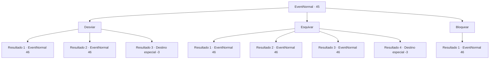

# Eventos normais · 45

[Índice da tabela](index.md) · [Índice geral](../index.md)

ID: `pt:EventNormal:45` · Fonte: `EventNormal4` · Versão: 1.2.47.

Mapeamento estático dos arquivos; a disponibilidade e a execução dependem do estado da run.

## Texto do evento

Você ouve algo se mover silenciosamente nos arbustos. Então de repente 
WHIZZZ---!
 Algo voa em sua direção pelo ar.

## Dados de entrada

```json
{
  "id": 45,
  "grade": 1,
  "place": "",
  "required": "2_2_60"
}
```

## Mapa das escolhas



## Escolhas e resultados

### Escolha 1

Desviar

Requisitos e outros campos da escolha:

```json
{
  "required": ""
}
```

#### Resultado 1.1

Você não consegue se esquivar. A flecha da besta segue através de sua armadura e até atingir seu braço. Um grupo de bandidos e seu líder saem do esconderijo. Eles vêem que você está ferido e vêm em sua direção agressivamente.

Continuação registrada: [Evento 46](0046.md) na mesma tabela.

```json
{
  "required": "1_0_2",
  "chance": "6",
  "nextEvent": 46,
  "type": 1,
  "reward": "0_0_-1|6_3_24",
  "place": 1
}
```

#### Resultado 1.2

Você se esquiva com um movimento mínimo.  A seta da besta atinge sua cintura.  Um grupo de bandidos e seu líder saem do esconderijo.

Continuação registrada: [Evento 46](0046.md) na mesma tabela.

```json
{
  "required": "",
  "chance": "1|0_6_1",
  "nextEvent": 46,
  "type": 0,
  "reward": "6_0_24|0_2_1",
  "place": 1
}
```

#### Resultado 1.3

Você não consegue se esquivar. A flecha da besta segue através de sua armadura até atingir o seu peito. Você cai e desmaia.

Continuação registrada: [Destino especial `-3`](../destinos-especiais.md).

```json
{
  "required": "2_0_2",
  "chance": "8",
  "nextEvent": -3,
  "type": 1,
  "reward": "0_0_-1"
}
```

### Escolha 2

Esquivar

Requisitos e outros campos da escolha:

```json
{
  "required": ""
}
```

#### Resultado 2.1

Você tenta esquivar, mas não consegue. A flecha da besta segue através de sua armadura até atingir seu braço. Um grupo de bandidos e seu líder saem do esconderijo. Eles vêem que você está ferido e vêm em sua direção agressivamente.

Continuação registrada: [Evento 46](0046.md) na mesma tabela.

```json
{
  "required": "1_0_2",
  "chance": "20",
  "nextEvent": 46,
  "type": 1,
  "reward": "0_0_-1|6_3_24",
  "place": 1
}
```

#### Resultado 2.2

Você consegue desviar. A flecha da besta cai no chão. Um grupo de bandidos e seu líder saem do esconderijo.

Continuação registrada: [Evento 46](0046.md) na mesma tabela.

```json
{
  "required": "",
  "chance": "1|0_5_2",
  "nextEvent": 46,
  "type": 0,
  "reward": "6_0_24|0_2_1",
  "place": 1
}
```

#### Resultado 2.3

Você manda a flecha de volta na direção de onde veio. A flecha atinge seu dono. O bandido cai com um grito, e os restantes saltam com seu líder. Eles parecem intimidados por suas habilidades. <link=shake>

 "Vamos lá! Busquem aquele bastardo!"

</link> O líder late, e os bandidos obedecem.

Continuação registrada: [Evento 46](0046.md) na mesma tabela.

```json
{
  "required": "",
  "chance": "1|0_5_1",
  "nextEvent": 46,
  "type": 0,
  "reward": "6_2_24|0_2_1",
  "place": 1
}
```

#### Resultado 2.4

Você falha em esquivar. A flecha da besta atravessa sua armadura até atingir o seu peito. Você cai e desmaia no local.

Continuação registrada: [Destino especial `-3`](../destinos-especiais.md).

```json
{
  "required": "2_0_2",
  "chance": "30",
  "nextEvent": -3,
  "type": 1,
  "reward": "0_0_-1"
}
```

### Escolha 3

Bloquear

Requisitos e outros campos da escolha:

```json
{
  "required": "20_9_1"
}
```

#### Resultado 3.1

Você bloqueia.  A flecha da besta cai no chão.  Um grupo de bandidos e seu líder saem do esconderijo.

Continuação registrada: [Evento 46](0046.md) na mesma tabela.

```json
{
  "required": "",
  "chance": "1",
  "nextEvent": 46,
  "type": 2,
  "reward": "6_0_24|0_2_1",
  "place": 1
}
```

## Referências que chegam a este evento

Nenhum `nextEvent` positivo da mesma tabela aponta para este nó. Isso não prova que seja inacessível: sorteio e estado de história podem selecioná-lo.

