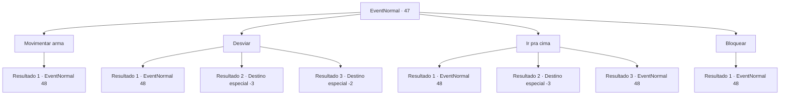

# Eventos normais · 47

[Índice da tabela](index.md) · [Índice geral](../index.md)

ID: `pt:EventNormal:47` · Fonte: `EventNormal4` · Versão: 1.2.47.

Mapeamento estático dos arquivos; a disponibilidade e a execução dependem do estado da run.

## Texto do evento

Você encontra uma pequena caverna em uma montanha rochosa. Parece ter sido o lar de bandidos. Você entra na caverna. A passagem se estreita e se alarga até que se abre em uma sala. |drawing_cave| Nela está um goblin vestido com uma armadura extravagante. É um hobgoblin, e ele avança em você no momento em que te vê. 

## Dados de entrada

```json
{
  "id": 47,
  "grade": 1,
  "place": "",
  "required": "2_2_60"
}
```

## Mapa das escolhas



## Escolhas e resultados

### Escolha 1

Movimentar arma

Requisitos e outros campos da escolha:

```json
{
  "required": ""
}
```

#### Resultado 1.1

Você movimenta sua arma contra o hobgoblin que está atacando.  Ele para e bloqueia seu ataque com um escudo.  

 "Grrrr ... Humano ...! Matar..!"


Continuação registrada: [Evento 48](0048.md) na mesma tabela.

```json
{
  "required": "",
  "chance": "1",
  "nextEvent": 48,
  "type": 2,
  "reward": "6_0_22",
  "place": 6
}
```

### Escolha 2

Desviar

Requisitos e outros campos da escolha:

```json
{
  "required": ""
}
```

#### Resultado 2.1

Você não consegue se esquivar do hobgoblin que está atacando.  Os espinhos da armadura dele cravam em sua carne.  Você sente uma dor imensa e desmaia. Os olhos do hobgoblin se retorcem enquanto ele gargalha.  Ele se aproxima de você com confiança.

Continuação registrada: [Evento 48](0048.md) na mesma tabela.

```json
{
  "required": "1_0_2",
  "chance": "10",
  "nextEvent": 48,
  "type": 1,
  "reward": "6_0_22|0_0_-1",
  "place": 6
}
```

#### Resultado 2.2

Você não consegue se esquivar do hobgoblin que está atacando.  Os espinhos da armadura dele cravam em sua carne.  Você sente uma dor imensa enquanto sua mente escurece.

Continuação registrada: [Destino especial `-3`](../destinos-especiais.md).

```json
{
  "required": "2_0_2",
  "chance": "10",
  "nextEvent": -3,
  "type": 1,
  "reward": "0_0_-1"
}
```

#### Resultado 2.3

Você esquiva agilmente do hobgoblin que está atacando.  Então você põe o pé no caminho.  O hobgoblin tropeça e cai no fundo da caverna.  <link=shake>

 "KHREEEE !!!"

</link>  Ele grita no longo caminho para baixo. Ele fica em silêncio ao atingir o solo.  Você olha para baixo por um momento antes de prosseguir.

Continuação registrada: [Destino especial `-2`](../destinos-especiais.md).

```json
{
  "required": "",
  "chance": "1|0_6_1",
  "nextEvent": -2,
  "type": 0,
  "reward": "0_2_1"
}
```

### Escolha 3

Ir pra cima

Requisitos e outros campos da escolha:

```json
{
  "required": ""
}
```

#### Resultado 3.1

Você se choca contra o hobgoblin que estava atacando.  Ao bater nele, você sente uma dor imensa e desmaia.  Os olhos do hobgoblin se retorcem enquanto ele gargalha.  Ele se aproxima de você com confiança.

Continuação registrada: [Evento 48](0048.md) na mesma tabela.

```json
{
  "required": "1_0_2",
  "chance": "8",
  "nextEvent": 48,
  "type": 1,
  "reward": "6_0_22|0_0_-1",
  "place": 6
}
```

#### Resultado 3.2

Você se choca contra o hobgoblin que estava atacando. Ao bater nele,  você sente uma dor imensa e sua mente escurece.

Continuação registrada: [Destino especial `-3`](../destinos-especiais.md).

```json
{
  "required": "2_0_2",
  "chance": "8",
  "nextEvent": -3,
  "type": 1,
  "reward": "0_0_-1"
}
```

#### Resultado 3.3

Você se choca contra o hobgoblin que estava atacando.  Quando você o acerta, o hobgoblin cai de forma miserável.  

 "Grrrr ... KCHEE ...!"

  Ele cospe um dente ensanguentado e vem em sua direção novamente.

Continuação registrada: [Evento 48](0048.md) na mesma tabela.

```json
{
  "required": "",
  "chance": "1|0_5_1",
  "nextEvent": 48,
  "type": 0,
  "reward": "6_2_22",
  "place": 6
}
```

### Escolha 4

Bloquear

Requisitos e outros campos da escolha:

```json
{
  "required": "20_9_1"
}
```

#### Resultado 4.1

Você bloqueia o hobgoblin que está atacando.  Ele desaba miseravelmente no chão.  

 "Grrrr ... KCHEE ...!"

  Ele cospe um dente ensanguentado e vem em sua direção novamente.

Continuação registrada: [Evento 48](0048.md) na mesma tabela.

```json
{
  "required": "",
  "chance": "1",
  "nextEvent": 48,
  "type": 2,
  "reward": "6_2_22",
  "place": 6
}
```

## Referências que chegam a este evento

Nenhum `nextEvent` positivo da mesma tabela aponta para este nó. Isso não prova que seja inacessível: sorteio e estado de história podem selecioná-lo.

