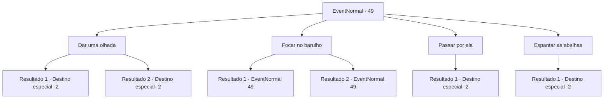

# Eventos normais · 49

[Índice da tabela](index.md) · [Índice geral](../index.md)

ID: `pt:EventNormal:49` · Fonte: `EventNormal4` · Versão: 1.2.47.

Mapeamento estático dos arquivos; a disponibilidade e a execução dependem do estado da run.

## Texto do evento

Você encontra uma carruagem abandonada. Um barulho estranho está vindo de dentro.

## Dados de entrada

```json
{
  "id": 49,
  "grade": 1,
  "place": "",
  "required": "5_30_0"
}
```

## Mapa das escolhas



## Escolhas e resultados

### Escolha 1

Dar uma olhada

Requisitos e outros campos da escolha:

```json
{
  "required": ""
}
```

#### Resultado 1.1

Você abre a porta da carruagem.  Lá dentro estão várias vespas e milhares de abelhas lutando por uma colmeia.  As abelhas se aglomeram ao redor e picam você.  Você recua enquanto balança os braços.

Continuação registrada: [Destino especial `-2`](../destinos-especiais.md).

```json
{
  "required": "",
  "chance": "10",
  "nextEvent": -2,
  "type": 1,
  "reward": "0_0_-1|5_30_1"
}
```

#### Resultado 1.2

Você abre a porta da carruagem.  Lá dentro estão várias vespas e milhares de abelhas lutando por uma colmeia.  Você usa seus poderes para silenciá-los instantaneamente.  Você pega o que precisa da carruagem.

Continuação registrada: [Destino especial `-2`](../destinos-especiais.md).

```json
{
  "required": "",
  "chance": "1|0_12_1",
  "nextEvent": -2,
  "type": 0,
  "reward": "0_4_2|3_44_1|3_42_1|0_2_1|5_30_1"
}
```

### Escolha 2

Focar no barulho

Requisitos e outros campos da escolha:

```json
{
  "required": "5_30_0"
}
```

#### Resultado 2.1

Você se concentra no barulho, mas não consegue descobrir o que poderia fazer tal som.

Continuação registrada: [Evento 49](0049.md) na mesma tabela.

```json
{
  "required": "",
  "chance": "4",
  "nextEvent": 49,
  "type": 1,
  "reward": "5_30_1"
}
```

#### Resultado 2.2

Você se concentra no barulho.  É o som de incontáveis ​​asas de insetos batendo.  Você se concentra mais e descobre que os insetos são abelhas.

Continuação registrada: [Evento 49](0049.md) na mesma tabela.

```json
{
  "required": "",
  "chance": "1|0_7_1",
  "nextEvent": 49,
  "type": 0,
  "reward": "5_30_2"
}
```

### Escolha 3

Passar por ela

Requisitos e outros campos da escolha:

```json
{
  "required": ""
}
```

#### Resultado 3.1

Você passa pela carruagem sinistra.

Continuação registrada: [Destino especial `-2`](../destinos-especiais.md).

```json
{
  "required": "",
  "chance": "1",
  "nextEvent": -2,
  "type": 2,
  "reward": "5_30_1"
}
```

### Escolha 4

Espantar as abelhas

Requisitos e outros campos da escolha:

```json
{
  "required": "5_30_2"
}
```

#### Resultado 4.1

Você esfumaça as abelhas.  Elas vêm inundando para fora.  Momentos depois, você entra e pega o que precisa.

Continuação registrada: [Destino especial `-2`](../destinos-especiais.md).

```json
{
  "required": "",
  "chance": "1",
  "nextEvent": -2,
  "type": 2,
  "reward": "0_4_2|3_44_1|3_42_1|0_2_1|5_30_1"
}
```

## Referências que chegam a este evento

- [Evento 49 · escolha 2 · resultado 1](0049.md#escolha-2)
- [Evento 49 · escolha 2 · resultado 2](0049.md#escolha-2)
