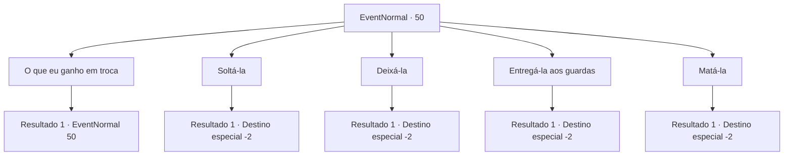

# Eventos normais · 50

[Índice da tabela](index.md) · [Índice geral](../index.md)

ID: `pt:EventNormal:50` · Fonte: `EventNormal4` · Versão: 1.2.47.

Mapeamento estático dos arquivos; a disponibilidade e a execução dependem do estado da run.

## Texto do evento

Você ouve alguém chamando. 

 "Você, criança .."

 Parece uma idosa e você sente como se ela estivesse na sua cabeça. Você está se perguntando de onde vem a voz, quando de repente ela volta. 

 "Aqui... À sua direita..."

 Alguém está chamando você de uma pilha de lixo e tábuas de madeira. Você vai e encontra uma idosa vestida com roupas e punhos de prisão. Ela pede para você soltá-la.

## Dados de entrada

```json
{
  "id": 50,
  "grade": 1,
  "place": "",
  "required": "5_6_0|18_63_2|2_2_20"
}
```

## Mapa das escolhas



## Escolhas e resultados

### Escolha 1

O que eu ganho em troca

Requisitos e outros campos da escolha:

```json
{
  "required": "5_6_0"
}
```

#### Resultado 1.1

<link=wave>

 "Não sei ... Meu amor eterno? HAHAHA!"

</link>  A mulher riu um pouco antes de continuar.  

 "Não tenho muito no momento, mas terei se você me libertar."

  Ela sorriu ao olhar para você. As rugas dela pareceram se aprofundar.

Continuação registrada: [Evento 50](0050.md) na mesma tabela.

```json
{
  "required": "",
  "chance": "1",
  "nextEvent": 50,
  "type": 2,
  "reward": "5_6_1"
}
```

### Escolha 2

Soltá-la

Requisitos e outros campos da escolha:

```json
{
  "required": ""
}
```

#### Resultado 2.1

Você quebra as algemas dela.  

 "Obrigado criança. Agora me sinto viva!"

  Ela se espreguiçou e instantaneamente se transformou em uma bela jovem.  Então ela abre um portal no ar com um estalar de dedos.  

 "Uau! Eles teriam me queimado viva. Até mais!"

  Ela desaparece no portal.

Continuação registrada: [Destino especial `-2`](../destinos-especiais.md).

```json
{
  "required": "",
  "chance": "1",
  "nextEvent": -2,
  "type": 2,
  "reward": "5_6_2|0_2_2"
}
```

### Escolha 3

Deixá-la

Requisitos e outros campos da escolha:

```json
{
  "required": ""
}
```

#### Resultado 3.1


 "Você vai se arrepender disso ... Seu perdedor."

 Você deixa a velha para trás e segue em frente.

Continuação registrada: [Destino especial `-2`](../destinos-especiais.md).

```json
{
  "required": "",
  "chance": "1",
  "nextEvent": -2,
  "type": 2,
  "reward": "0_2_1|5_6_3"
}
```

### Escolha 4

Entregá-la aos guardas

Requisitos e outros campos da escolha:

```json
{
  "required": ""
}
```

#### Resultado 4.1

Você leva a velha com roupas de prisão para os guardas.  Ela pragueja e grita com você o tempo todo.  Você está livre dos palavrões dela somente após entregá-la.  

 "Obrigado por seus esforços. Ela é uma bruxa perigosa e nós a teríamos perdido se não fosse por você."

  Os guardas agradecem e recompensam você com dinheiro.

Continuação registrada: [Destino especial `-2`](../destinos-especiais.md).

```json
{
  "required": "",
  "chance": "1",
  "nextEvent": -2,
  "type": 2,
  "reward": "0_2_1|0_4_100|5_6_3"
}
```

### Escolha 5

Matá-la

Requisitos e outros campos da escolha:

```json
{
  "required": "2_3_0"
}
```

#### Resultado 5.1

Você mata a velha sem saber por que ela foi condenada.  O sangue dela pinta a rua de roxo.  Você pega o cadáver dela e entrega aos guardas.  

 "Obrigado por seus esforços. Ela é uma bruxa perigosa e nós a teríamos perdido se não fosse por você."


Continuação registrada: [Destino especial `-2`](../destinos-especiais.md).

```json
{
  "required": "",
  "chance": "1",
  "nextEvent": -2,
  "type": 2,
  "reward": "0_3_-10|0_2_1|0_4_70|5_6_3"
}
```

## Referências que chegam a este evento

- [Evento 50 · escolha 1 · resultado 1](0050.md#escolha-1)
