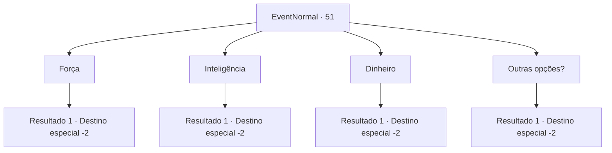

# Eventos normais · 51

[Índice da tabela](index.md) · [Índice geral](../index.md)

ID: `pt:EventNormal:51` · Fonte: `EventNormal4` · Versão: 1.2.47.

Mapeamento estático dos arquivos; a disponibilidade e a execução dependem do estado da run.

## Texto do evento

Você percebe que algo está sentado em seu ombro. Você se vira e vê uma coruja empoleirada nele, olhando para você. Surpreendentemente, a coruja fala com você em ventríloquo. 

 "Você parece bastante assustado. Esta coruja é minha conhecida."

 Você reconhece a voz dela do depósito de lixo. Ela diz para você escolher o que deseja entre 3 opções. 

## Dados de entrada

```json
{
  "id": 51,
  "grade": 1,
  "place": "",
  "required": "5_6_2|18_88_1"
}
```

## Mapa das escolhas



## Escolhas e resultados

### Escolha 1

Força

Requisitos e outros campos da escolha:

```json
{
  "required": ""
}
```

#### Resultado 1.1

Você diz que quer força.  Ela prontamente concorda.  A coruja pega uma poção e entrega a você.  

 "Contém a receita para força. Você pode se tornar um pouco menos inteligente. Efeito colateral menor."

  A coruja desaparece em uma nuvem de fumaça enquanto você toma a poção.

Continuação registrada: [Destino especial `-2`](../destinos-especiais.md).

```json
{
  "required": "",
  "chance": "1",
  "nextEvent": -2,
  "type": 2,
  "reward": "0_2_1|3_99_1|5_6_4"
}
```

### Escolha 2

Inteligência

Requisitos e outros campos da escolha:

```json
{
  "required": ""
}
```

#### Resultado 2.1

Você diz que quer conhecimento.  Ela prontamente concorda.  A coruja pega uma poção e entrega a você.  

 "Contém a receita para a inteligência. Você pode perder alguns músculos. Efeito colateral menor."

  A coruja desaparece em uma nuvem de fumaça enquanto você toma a poção.

Continuação registrada: [Destino especial `-2`](../destinos-especiais.md).

```json
{
  "required": "",
  "chance": "1",
  "nextEvent": -2,
  "type": 2,
  "reward": "0_2_1|3_100_1|5_6_4"
}
```

### Escolha 3

Dinheiro

Requisitos e outros campos da escolha:

```json
{
  "required": ""
}
```

#### Resultado 3.1

Você diz que quer dinheiro.  Ela prontamente concorda.  A coruja pega uma bolsa com dinheiro e entrega a você.  

 "Aqui. Pegue."

  A coruja desaparece em uma nuvem de fumaça quando você pega a bolsa.

Continuação registrada: [Destino especial `-2`](../destinos-especiais.md).

```json
{
  "required": "",
  "chance": "1",
  "nextEvent": -2,
  "type": 2,
  "reward": "0_2_1|0_4_60|5_6_4"
}
```

### Escolha 4

Outras opções?

Requisitos e outros campos da escolha:

```json
{
  "required": ""
}
```

#### Resultado 4.1

Você pede a ela outras opções. Ela pensa por um momento antes de concordar. Um pequeno portal se abre, para o qual a coruja voa. Você segue a coruja para dentro. Após uma sequência de tecartansporte nauseante, você chega a uma confortável sala de estar perto da lareira. 

 "Bem vindo. Suponho que você nunca esteve na casa de uma bruxa antes, não é?"

 Agora jovem, a velha que você salvou antes lhe entrega um livro, oferecendo para lhe ensinar magia básica. 

 Nos próximos dias, você aprende as teorias fundamentais da magia com ela. Depois de tudo feito, ela o manda de volta para onde você estava.

Continuação registrada: [Destino especial `-2`](../destinos-especiais.md).

```json
{
  "required": "",
  "chance": "1",
  "nextEvent": -2,
  "type": 2,
  "reward": "0_2_2|3_53_1|5_6_4|0_7_1"
}
```

## Referências que chegam a este evento

Nenhum `nextEvent` positivo da mesma tabela aponta para este nó. Isso não prova que seja inacessível: sorteio e estado de história podem selecioná-lo.

