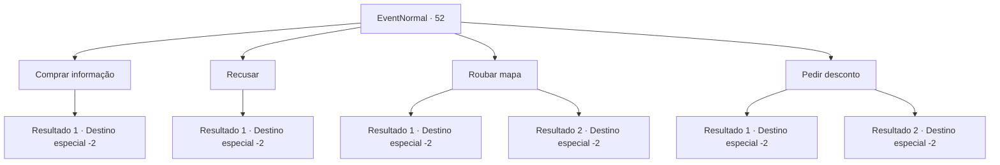

# Eventos normais · 52

[Índice da tabela](index.md) · [Índice geral](../index.md)

ID: `pt:EventNormal:52` · Fonte: `EventNormal4` · Versão: 1.2.47.

Mapeamento estático dos arquivos; a disponibilidade e a execução dependem do estado da run.

## Texto do evento

Você encontra um mercador viajante na estrada. Ele corre até você, acenando feliz. 

 "Aventureiro! Aventureiro! Tenho algumas informações interessantes, gostaria de ouvi-las? Vou vendê-las a um preço muito razoável."


## Dados de entrada

```json
{
  "id": 52,
  "grade": 1,
  "place": "",
  "required": "10_55_1|5_39_0"
}
```

## Mapa das escolhas



## Escolhas e resultados

### Escolha 1

Comprar informação

Requisitos e outros campos da escolha:

```json
{
  "required": "1_4_20"
}
```

#### Resultado 1.1

Você concorda em ouvi-lo e entrega o ouro. Ele sorri enquanto embolsa o dinheiro. O comerciante usa um mapa ilustrado para explicar. 

 "Nesse lugar jaz uma gigante, e quero dizer gigante mesmo, uma cobra. De acordo com os anões que moravam lá, tem uma maça de ferro como cauda e respira fogo."

 Em seguida, ele acrescenta, em um sussurro. 

 "E também há um grande tesouro!"

 Ele lhe entrega o mapa e sai.

Continuação registrada: [Destino especial `-2`](../destinos-especiais.md).

```json
{
  "required": "",
  "chance": "1",
  "nextEvent": -2,
  "type": 2,
  "reward": "0_4_-20|3_55_1|0_2_1|5_39_1"
}
```

### Escolha 2

Recusar

Requisitos e outros campos da escolha:

```json
{
  "required": ""
}
```

#### Resultado 2.1

Você recusa a oferta dele.  

 "Hmph ... Você definitivamente vai se arrepender disso ..."

  Ele resmunga e sai.

Continuação registrada: [Destino especial `-2`](../destinos-especiais.md).

```json
{
  "required": "",
  "chance": "1",
  "nextEvent": -2,
  "type": 2,
  "reward": "0_2_1|5_39_9"
}
```

### Escolha 3

Roubar mapa

Requisitos e outros campos da escolha:

```json
{
  "required": ""
}
```

#### Resultado 3.1

Você recusa a oferta dele.  Enquanto o comerciante resmunga e passa por você,  você rapidamente rouba o mapa dele.  Ele se afasta sem perceber.

Continuação registrada: [Destino especial `-2`](../destinos-especiais.md).

```json
{
  "required": "",
  "chance": "1|0_6_1",
  "nextEvent": -2,
  "type": 0,
  "reward": "3_55_1|0_3_-1|0_2_1|5_39_1"
}
```

#### Resultado 3.2

Você recusa a oferta dele.  Enquanto o comerciante resmunga e passa por você,  você rapidamente tenta roubar o mapa dele, mas falha.  Ele se afasta sem perceber.

Continuação registrada: [Destino especial `-2`](../destinos-especiais.md).

```json
{
  "required": "",
  "chance": "3",
  "nextEvent": -2,
  "type": 1,
  "reward": "0_3_-1|5_39_9"
}
```

### Escolha 4

Pedir desconto

Requisitos e outros campos da escolha:

```json
{
  "required": "1_4_10"
}
```

#### Resultado 4.1

Você tenta obter o mapa por um preço mais barato,  mas ele educadamente recusa e vai embora.

Continuação registrada: [Destino especial `-2`](../destinos-especiais.md).

```json
{
  "required": "",
  "chance": "10",
  "nextEvent": -2,
  "type": 1,
  "reward": "5_39_9"
}
```

#### Resultado 4.2

Você consegue reduzir o preço pela metade graças à sua língua de prata.  Ele sorri ao entregar a carta para você, mas a mão dele está tremendo.  Ele fala enquanto embolsa o dinheiro.  

 "Então, se você olhar para o mapa aqui ..."

  O comerciante usa um mapa ilustrado para explicar.  

 "Nesse lugar jaz uma gigante, e quero dizer gigante mesmo, uma cobra.  De acordo com os anões que moravam lá,  tem uma maça de ferro como cauda e respira fogo."

  Em seguida, ele acrescenta, em um sussurro.  

 "E também há um grande tesouro!"

  Ele lhe entrega o mapa e sai.

Continuação registrada: [Destino especial `-2`](../destinos-especiais.md).

```json
{
  "required": "",
  "chance": "1|0_7_1",
  "nextEvent": -2,
  "type": 0,
  "reward": "0_4_-10|3_55_1|0_2_1|5_39_1"
}
```

## Referências que chegam a este evento

Nenhum `nextEvent` positivo da mesma tabela aponta para este nó. Isso não prova que seja inacessível: sorteio e estado de história podem selecioná-lo.

