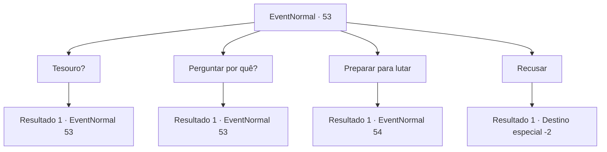

# Eventos normais · 53

[Índice da tabela](index.md) · [Índice geral](../index.md)

ID: `pt:EventNormal:53` · Fonte: `EventNormal4` · Versão: 1.2.47.

Mapeamento estático dos arquivos; a disponibilidade e a execução dependem do estado da run.

## Texto do evento

Você pega o mapa que comprou do mercador e segue suas instruções. O lugar é de fato o lar de uma cobra gigante. O que o mercador não sabe, porém, é que a cobra já está morta. 

 "Não... eu matei outra..."

 Em cima do cadáver da cobra está um homem grande com uma barba ruiva. Ele respira pesadamente, as cicatrizes em seus músculos flexionam enquanto faz isso. Ele diz. 

 "Agora é sua vez de me matar."

 

## Dados de entrada

```json
{
  "id": 53,
  "grade": 1,
  "place": "",
  "required": "8_55_1|5_39_1|1_2_30"
}
```

## Mapa das escolhas



## Escolhas e resultados

### Escolha 1

Tesouro?

Requisitos e outros campos da escolha:

```json
{
  "required": "5_33_0"
}
```

#### Resultado 1.1

Você pergunta a ele onde está o tesouro.  Ele balança a cabeça e diz que não existe tal coisa.  Ele parece falar a verdade.

Continuação registrada: [Evento 53](0053.md) na mesma tabela.

```json
{
  "required": "",
  "chance": "1",
  "nextEvent": 53,
  "type": 2,
  "reward": "5_33_1"
}
```

### Escolha 2

Perguntar por quê?

Requisitos e outros campos da escolha:

```json
{
  "required": "5_34_0"
}
```

#### Resultado 2.1

Você pergunta a ele por que você deve lutar.  

 "Bem ... Se você está curioso, eu vou te dizer. Eu ouvi uma profecia. Que eu vou morrer em casa, tranquilo, de velhice."

  Ele parece estar contendo a raiva. Há um momento de silêncio antes que ele fale novamente.  

 "Então, estou viajando e lutando para provar que a profecia é uma besteira completa.
  Esta cobra não conseguiu me matar, então espero que você tenha sucesso.  É a verdadeira honra de um guerreiro morrer em batalha."


Continuação registrada: [Evento 53](0053.md) na mesma tabela.

```json
{
  "required": "",
  "chance": "1",
  "nextEvent": 53,
  "type": 2,
  "reward": "5_34_1"
}
```

### Escolha 3

Preparar para lutar

Requisitos e outros campos da escolha:

```json
{
  "required": ""
}
```

#### Resultado 3.1

Você puxa sua arma e se prepara para lutar contra ele.  Ele pega uma lança gigante. Sorrindo, ele caminha em sua direção.

Continuação registrada: [Evento 54](0054.md) na mesma tabela.

```json
{
  "required": "",
  "chance": "1",
  "nextEvent": 54,
  "type": 2,
  "reward": "6_0_47",
  "place": 5
}
```

### Escolha 4

Recusar

Requisitos e outros campos da escolha:

```json
{
  "required": ""
}
```

#### Resultado 4.1

Você não vê razão para lutar com ele.  

 "Então saia da minha vista."

  Ele parece ofendido com a sua recusa, enquanto o empurra de lado e sai.

Continuação registrada: [Destino especial `-2`](../destinos-especiais.md).

```json
{
  "required": "",
  "chance": "1",
  "nextEvent": -2,
  "type": 2,
  "reward": "0_1_-1|5_39_9|0_2_1"
}
```

## Referências que chegam a este evento

- [Evento 53 · escolha 1 · resultado 1](0053.md#escolha-1)
- [Evento 53 · escolha 2 · resultado 1](0053.md#escolha-2)
