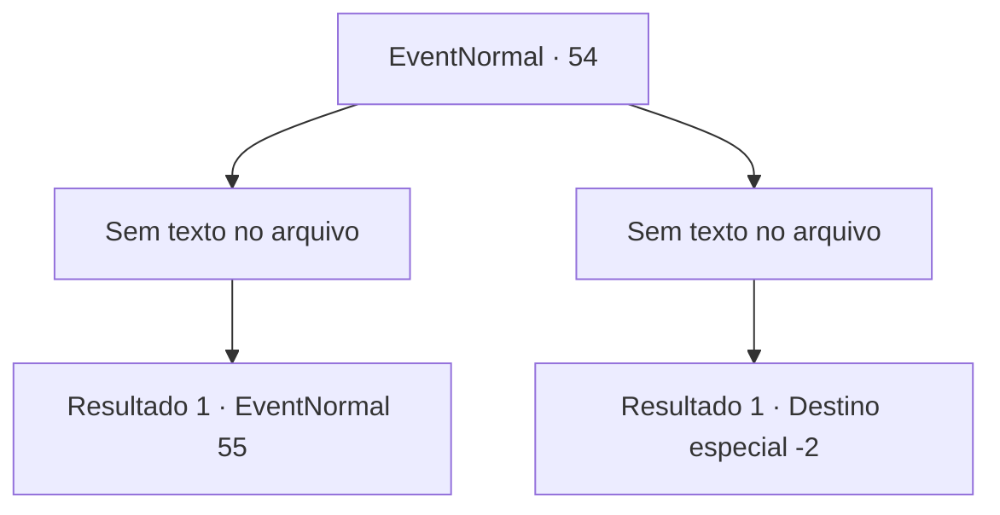

# Eventos normais · 54

[Índice da tabela](index.md) · [Índice geral](../index.md)

ID: `pt:EventNormal:54` · Fonte: `EventNormal4` · Versão: 1.2.47.

Mapeamento estático dos arquivos; a disponibilidade e a execução dependem do estado da run.

## Texto do evento

*Sem texto no arquivo.*

## Dados de entrada

```json
{
  "id": 54,
  "grade": 1,
  "place": "",
  "required": ""
}
```

## Mapa das escolhas



## Escolhas e resultados

### Escolha 1

*Sem texto no arquivo; o papel dessa opção depende da interface do jogo.*

Requisitos e outros campos da escolha:

```json
{
  "required": ""
}
```

#### Resultado 1.1

Você derrota o berserker de barba ruiva.  O sangue dele flui mais vermelho do que a própria barba, mas ele está sorrindo.  

 "Provei ... A maldita velha senhora ... profecia ... errada. Tire minha vida."


Continuação registrada: [Evento 55](0055.md) na mesma tabela.

```json
{
  "required": "",
  "chance": "1",
  "nextEvent": 55,
  "type": 2,
  "reward": "5_39_9"
}
```

### Escolha 2

*Sem texto no arquivo; o papel dessa opção depende da interface do jogo.*

Requisitos e outros campos da escolha:

```json
{
  "required": ""
}
```

#### Resultado 2.1

Você desmaia após uma batalha intensa com o berserker de barba ruiva.  Ele olha para você, murmura que não ficou impressionado e vai embora.

Continuação registrada: [Destino especial `-2`](../destinos-especiais.md).

```json
{
  "required": "",
  "chance": "5",
  "nextEvent": -2,
  "type": 2,
  "reward": "0_0_-1|0_2_1|5_39_9"
}
```

## Referências que chegam a este evento

- [Evento 53 · escolha 3 · resultado 1](0053.md#escolha-3)
