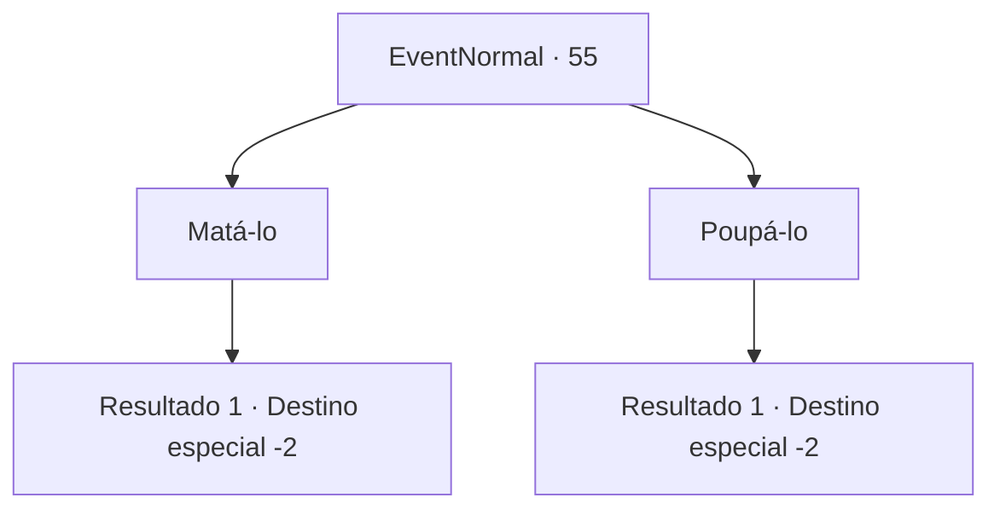

# Eventos normais · 55

[Índice da tabela](index.md) · [Índice geral](../index.md)

ID: `pt:EventNormal:55` · Fonte: `EventNormal4` · Versão: 1.2.47.

Mapeamento estático dos arquivos; a disponibilidade e a execução dependem do estado da run.

## Texto do evento

*Sem texto no arquivo.*

## Dados de entrada

```json
{
  "id": 55,
  "grade": 1,
  "place": "",
  "required": ""
}
```

## Mapa das escolhas



## Escolhas e resultados

### Escolha 1

Matá-lo

Requisitos e outros campos da escolha:

```json
{
  "required": ""
}
```

#### Resultado 1.1

Você concede o desejo de acabar com a vida dele. Ele lhe entrega a lança. Você usa ela para acabar com a vida dele. Ele morre com um sorriso satisfeito no rosto. Você deixa o corpo dele para trás e segue em frente.

Continuação registrada: [Destino especial `-2`](../destinos-especiais.md).

```json
{
  "required": "",
  "chance": "1",
  "nextEvent": -2,
  "type": 2,
  "reward": "3_61_1|0_3_-5"
}
```

### Escolha 2

Poupá-lo

Requisitos e outros campos da escolha:

```json
{
  "required": ""
}
```

#### Resultado 2.1

Você diz a ele que não consegue.  Indignado, ele o empurra e vai embora.

Continuação registrada: [Destino especial `-2`](../destinos-especiais.md).

```json
{
  "required": "",
  "chance": "1",
  "nextEvent": -2,
  "type": 2,
  "reward": "0_3_1|0_2_1"
}
```

## Referências que chegam a este evento

- [Evento 54 · escolha 1 · resultado 1](0054.md#escolha-1)
