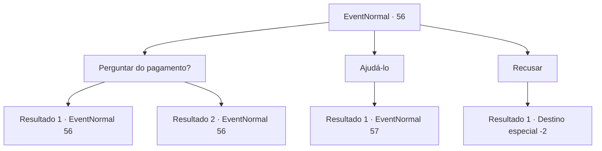

# Eventos normais · 56

[Índice da tabela](index.md) · [Índice geral](../index.md)

ID: `pt:EventNormal:56` · Fonte: `EventNormal4` · Versão: 1.2.47.

Mapeamento estático dos arquivos; a disponibilidade e a execução dependem do estado da run.

## Texto do evento

Você está caminhando à beira do rio quando um homem vem correndo. Ele, ofegante, pede um favor a você. 

 "Estimado.... aventureiro... Por favor me ajude..."

 Ele explica que um grupo de sahuagins veio e destruiu seu barco de pesca e sua rede, e ele mal conseguiu escapar. Ele pede que você o ajude a recuperar sua casa.

## Dados de entrada

```json
{
  "id": 56,
  "grade": 1,
  "place": "",
  "required": "5_27_0"
}
```

## Mapa das escolhas



## Escolhas e resultados

### Escolha 1

Perguntar do pagamento?

Requisitos e outros campos da escolha:

```json
{
  "required": "5_27_0"
}
```

#### Resultado 1.1


 "Pa..pagamento? Sim... eu tenho um pouco de... dinheiro."

 Ele gagueja e hesita. Mas ele então pega algumas moedas de ouro e mostra a você. São 10 ouros. Ele diz ser tudo o que tem.

Continuação registrada: [Evento 56](0056.md) na mesma tabela.

```json
{
  "required": "",
  "chance": "5",
  "nextEvent": 56,
  "type": 1,
  "reward": "5_27_1"
}
```

#### Resultado 1.2


 "Pa..pagamento? Sim... eu tenho um pouco de... dinheiro."

 Ele gagueja e hesita. Mas ele pega algumas moedas de ouro e mostra a você. São10 ouros. Ele diz ser tudo o que tem. Quando você franze a testa, ele te promete pagar um extra quando o trabalho for concluído.

Continuação registrada: [Evento 56](0056.md) na mesma tabela.

```json
{
  "required": "",
  "chance": "1|0_12_1",
  "nextEvent": 56,
  "type": 0,
  "reward": "5_27_2|0_4_10|0_2_1"
}
```

### Escolha 2

Ajudá-lo

Requisitos e outros campos da escolha:

```json
{
  "required": ""
}
```

#### Resultado 2.1

Você decide ajudá-lo. Você o segue até a sua casa desgatada na praia. Não há muito mais além de um barco de pesca e uma rede quebrados. Ele olha em volta enquanto fala. 

 "Ah... talvez tenhamos chegado tarde... Mas eles vão voltar, eu sei que vão. Por que não fazemos uma isca e esperamos?"


Continuação registrada: [Evento 57](0057.md) na mesma tabela.

```json
{
  "required": "",
  "chance": "1",
  "nextEvent": 57,
  "type": 2,
  "reward": ""
}
```

### Escolha 3

Recusar

Requisitos e outros campos da escolha:

```json
{
  "required": "18_27_2"
}
```

#### Resultado 3.1

Você recusa a oferta dele. Ele tristemente sai para procurar outra pessoa.

Continuação registrada: [Destino especial `-2`](../destinos-especiais.md).

```json
{
  "required": "",
  "chance": "1",
  "nextEvent": -2,
  "type": 2,
  "reward": "0_2_1|5_27_9"
}
```

## Referências que chegam a este evento

- [Evento 56 · escolha 1 · resultado 1](0056.md#escolha-1)
- [Evento 56 · escolha 1 · resultado 2](0056.md#escolha-1)
