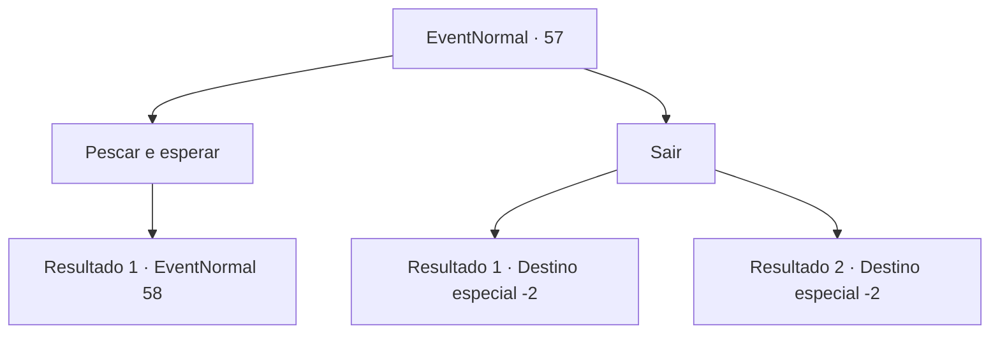

# Eventos normais · 57

[Índice da tabela](index.md) · [Índice geral](../index.md)

ID: `pt:EventNormal:57` · Fonte: `EventNormal4` · Versão: 1.2.47.

Mapeamento estático dos arquivos; a disponibilidade e a execução dependem do estado da run.

## Texto do evento

*Sem texto no arquivo.*

## Dados de entrada

```json
{
  "id": 57,
  "grade": 1,
  "place": "",
  "required": ""
}
```

## Mapa das escolhas



## Escolhas e resultados

### Escolha 1

Pescar e esperar

Requisitos e outros campos da escolha:

```json
{
  "required": ""
}
```

#### Resultado 1.1

Você coloca um pedaço sangrento de carne perto da água e espera.  Logo, os sahuagins aparecem.

Continuação registrada: [Evento 58](0058.md) na mesma tabela.

```json
{
  "required": "",
  "chance": "1",
  "nextEvent": 58,
  "type": 2,
  "reward": ""
}
```

### Escolha 2

Sair

Requisitos e outros campos da escolha:

```json
{
  "required": ""
}
```

#### Resultado 2.1

Você recusa a oferta dele. Ele tristemente sai para procurar outra pessoa.

Continuação registrada: [Destino especial `-2`](../destinos-especiais.md).

```json
{
  "required": "18_27_2",
  "chance": "1",
  "nextEvent": -2,
  "type": 2,
  "reward": "0_2_1|5_27_9"
}
```

#### Resultado 2.2

Você recusa a oferta e devolve o dinheiro. Ele sai tristemente para procurar outra pessoa.

Continuação registrada: [Destino especial `-2`](../destinos-especiais.md).

```json
{
  "required": "5_27_2",
  "chance": "1",
  "nextEvent": -2,
  "type": 2,
  "reward": "0_4_-10|0_2_1|5_27_9"
}
```

## Referências que chegam a este evento

- [Evento 56 · escolha 2 · resultado 1](0056.md#escolha-2)
