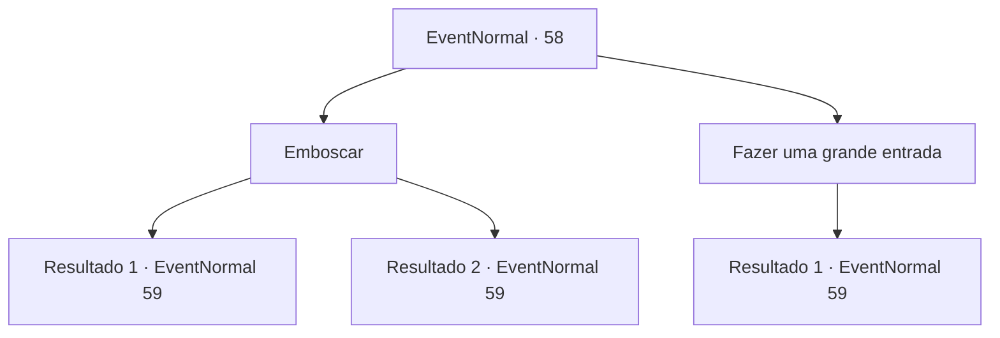

# Eventos normais · 58

[Índice da tabela](index.md) · [Índice geral](../index.md)

ID: `pt:EventNormal:58` · Fonte: `EventNormal4` · Versão: 1.2.47.

Mapeamento estático dos arquivos; a disponibilidade e a execução dependem do estado da run.

## Texto do evento

*Sem texto no arquivo.*

## Dados de entrada

```json
{
  "id": 58,
  "grade": 1,
  "place": "",
  "required": ""
}
```

## Mapa das escolhas



## Escolhas e resultados

### Escolha 1

Emboscar

Requisitos e outros campos da escolha:

```json
{
  "required": ""
}
```

#### Resultado 1.1

Você se aproxima com cuidado. Mas eles te encontram. Eles vêm até você com seus espinhos, gritando.

Continuação registrada: [Evento 59](0059.md) na mesma tabela.

```json
{
  "required": "",
  "chance": "5",
  "nextEvent": 59,
  "type": 1,
  "reward": "6_3_13",
  "place": 8
}
```

#### Resultado 1.2

Eles não percebem que você se aproxima deles porque estão distraídos com a isca.  Você cuidadosamente fica atrás de um deles e o esfaqueia no pescoço.  Seus olhos rolam para trás e ele morre instantaneamente, e então os outros vêm até você, gritando.

Continuação registrada: [Evento 59](0059.md) na mesma tabela.

```json
{
  "required": "",
  "chance": "1|0_6_1",
  "nextEvent": 59,
  "type": 0,
  "reward": "6_2_13",
  "place": 8
}
```

### Escolha 2

Fazer uma grande entrada

Requisitos e outros campos da escolha:

```json
{
  "required": ""
}
```

#### Resultado 2.1

Você se exibe e eles apontam seus espinhos para você, gritando.

Continuação registrada: [Evento 59](0059.md) na mesma tabela.

```json
{
  "required": "",
  "chance": "1",
  "nextEvent": 59,
  "type": 2,
  "reward": "6_0_13",
  "place": 8
}
```

## Referências que chegam a este evento

- [Evento 57 · escolha 1 · resultado 1](0057.md#escolha-1)
