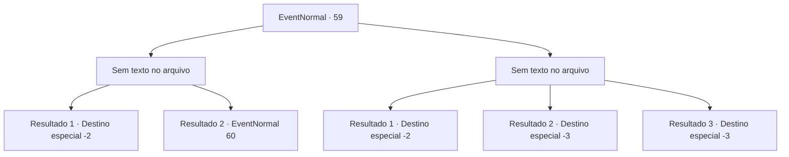

# Eventos normais · 59

[Índice da tabela](index.md) · [Índice geral](../index.md)

ID: `pt:EventNormal:59` · Fonte: `EventNormal4` · Versão: 1.2.47.

Mapeamento estático dos arquivos; a disponibilidade e a execução dependem do estado da run.

## Texto do evento

*Sem texto no arquivo.*

## Dados de entrada

```json
{
  "id": 59,
  "grade": 1,
  "place": "",
  "required": ""
}
```

## Mapa das escolhas



## Escolhas e resultados

### Escolha 1

*Sem texto no arquivo; o papel dessa opção depende da interface do jogo.*

Requisitos e outros campos da escolha:

```json
{
  "required": ""
}
```

#### Resultado 1.1

Os sahuagins caem mortos a seus pés.  O pescador, agora em lágrimas, agradece várias vezes.

Continuação registrada: [Destino especial `-2`](../destinos-especiais.md).

```json
{
  "required": "18_27_2",
  "chance": "1",
  "nextEvent": -2,
  "type": 2,
  "reward": "0_4_10|5_27_9"
}
```

#### Resultado 1.2

Os sahuagins caem mortos a seus pés. O pescador, agora em lágrimas, agradece várias vezes. Ele promete te recompensar e pede para que você venha em alguns dias.

Continuação registrada: [Evento 60](0060.md) na mesma tabela.

```json
{
  "required": "5_27_2",
  "chance": "1",
  "nextEvent": 60,
  "type": 2,
  "reward": "5_27_9"
}
```

### Escolha 2

*Sem texto no arquivo; o papel dessa opção depende da interface do jogo.*

Requisitos e outros campos da escolha:

```json
{
  "required": ""
}
```

#### Resultado 2.1

Você mal consegue escapar.  O pescador, que pediu sua ajuda, não está em lugar nenhum.

Continuação registrada: [Destino especial `-2`](../destinos-especiais.md).

```json
{
  "required": "1_0_2|1_1_2",
  "chance": "1",
  "nextEvent": -2,
  "type": 2,
  "reward": "0_0_-1|5_27_9"
}
```

#### Resultado 2.2

Os sahuagins te derrotam e te arrastam para o oceano.

Continuação registrada: [Destino especial `-3`](../destinos-especiais.md).

```json
{
  "required": "2_0_2",
  "chance": "1",
  "nextEvent": -3,
  "type": 2,
  "reward": "0_0_-1|0_1_-1"
}
```

#### Resultado 2.3

Os sahuagins te derrotam e te arrastam para o oceano.

Continuação registrada: [Destino especial `-3`](../destinos-especiais.md).

```json
{
  "required": "2_1_2",
  "chance": "1",
  "nextEvent": -3,
  "type": 2,
  "reward": "0_0_-1|0_1_-1"
}
```

## Referências que chegam a este evento

- [Evento 58 · escolha 1 · resultado 1](0058.md#escolha-1)
- [Evento 58 · escolha 1 · resultado 2](0058.md#escolha-1)
- [Evento 58 · escolha 2 · resultado 1](0058.md#escolha-2)
