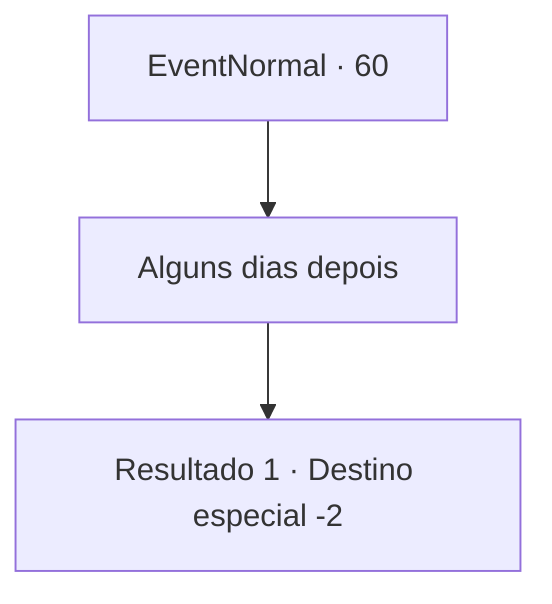

# Eventos normais · 60

[Índice da tabela](index.md) · [Índice geral](../index.md)

ID: `pt:EventNormal:60` · Fonte: `EventNormal4` · Versão: 1.2.47.

Mapeamento estático dos arquivos; a disponibilidade e a execução dependem do estado da run.

## Texto do evento

*Sem texto no arquivo.*

## Dados de entrada

```json
{
  "id": 60,
  "grade": 1,
  "place": "",
  "required": ""
}
```

## Mapa das escolhas



## Escolhas e resultados

### Escolha 1

Alguns dias depois

Requisitos e outros campos da escolha:

```json
{
  "required": ""
}
```

#### Resultado 1.1

Alguns dias se passam e você visita o pescador novamente. Ele sorri e dá as boas-vindas. Ele agradece novamente, dizendo que teria morrido de fome se não fosse por você. Ele tira uma pequena bolsa contendo um pouco de dinheiro. Em seguida, ele te convida a entrar e oferece a comida que preparou. Você come e continua sua jornada.

Continuação registrada: [Destino especial `-2`](../destinos-especiais.md).

```json
{
  "required": "",
  "chance": "1",
  "nextEvent": -2,
  "type": 2,
  "reward": "0_0_1|0_1_1|0_4_30"
}
```

## Referências que chegam a este evento

- [Evento 59 · escolha 1 · resultado 2](0059.md#escolha-1)
