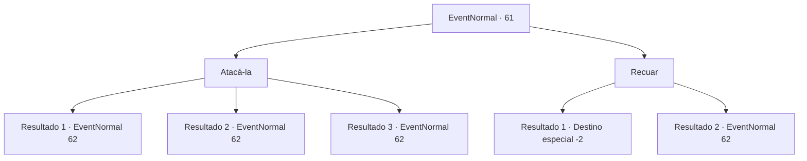

# Eventos normais · 61

[Índice da tabela](index.md) · [Índice geral](../index.md)

ID: `pt:EventNormal:61` · Fonte: `EventNormal4` · Versão: 1.2.47.

Mapeamento estático dos arquivos; a disponibilidade e a execução dependem do estado da run.

## Texto do evento

Você pega o mapa que comprou do mercador e segue suas instruções. O lugar é de fato o lar de uma cobra gigante. Enrolada, a cobra sibila para você para proteger seu ninho.

## Dados de entrada

```json
{
  "id": 61,
  "grade": 1,
  "place": "",
  "required": "8_55_1|5_39_1|1_2_30"
}
```

## Mapa das escolhas



## Escolhas e resultados

### Escolha 1

Atacá-la

Requisitos e outros campos da escolha:

```json
{
  "required": ""
}
```

#### Resultado 1.1

A cobra gigante cheira você com a língua. Conforme você dá um passo à frente, com arma em punho, ela abre as mandíbulas e vem em sua direção.

Continuação registrada: [Evento 62](0062.md) na mesma tabela.

```json
{
  "required": "",
  "chance": "1",
  "nextEvent": 62,
  "type": 2,
  "reward": "6_0_63",
  "place": 5
}
```

#### Resultado 1.2

A cobra gigante cheira você com a língua.  Quando você dá um passo à frente, com a arma em punho, ela se aproxima de você com medo extremo.

Continuação registrada: [Evento 62](0062.md) na mesma tabela.

```json
{
  "required": "8_69_1",
  "chance": "1",
  "nextEvent": 62,
  "type": 2,
  "reward": "6_2_63",
  "place": 5
}
```

#### Resultado 1.3

A cobra gigante cheira você com a língua.  Quando você dá um passo à frente, com a arma em punho, ela se aproxima de você com medo extremo.

Continuação registrada: [Evento 62](0062.md) na mesma tabela.

```json
{
  "required": "8_98_1",
  "chance": "1",
  "nextEvent": 62,
  "type": 2,
  "reward": "6_2_63",
  "place": 5
}
```

### Escolha 2

Recuar

Requisitos e outros campos da escolha:

```json
{
  "required": ""
}
```

#### Resultado 2.1

Você lentamente se afasta da cobra. Ela Parece cheia. Ela simplesmente olha para você enquanto você dá um passo para trás, com a língua entrando e saindo. Você se afasta da cobra gigante.

Continuação registrada: [Destino especial `-2`](../destinos-especiais.md).

```json
{
  "required": "",
  "chance": "1",
  "nextEvent": -2,
  "type": 2,
  "reward": "4_55_1|5_39_2"
}
```

#### Resultado 2.2

Você lentamente se afasta da cobra. Mas ela parece estar com fome. Ela percebe que você está fugindo. Ela abre suas mandíbulas e vem até você.

Continuação registrada: [Evento 62](0062.md) na mesma tabela.

```json
{
  "required": "10_69_1|10_98_1",
  "chance": "1",
  "nextEvent": 62,
  "type": 2,
  "reward": "6_0_63",
  "place": 5
}
```

## Referências que chegam a este evento

Nenhum `nextEvent` positivo da mesma tabela aponta para este nó. Isso não prova que seja inacessível: sorteio e estado de história podem selecioná-lo.

