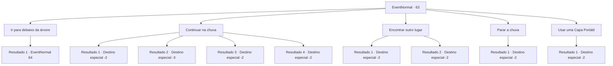

# Eventos normais · 63

[Índice da tabela](index.md) · [Índice geral](../index.md)

ID: `pt:EventNormal:63` · Fonte: `EventNormal4` · Versão: 1.2.47.

Mapeamento estático dos arquivos; a disponibilidade e a execução dependem do estado da run.

## Texto do evento

De repente nuvens se juntam acima de você e começa a chover. Felizmente, você vê uma árvore gigante. Parece que você pode se esconder da chuva lá.

## Dados de entrada

```json
{
  "id": 63,
  "grade": 1,
  "place": "",
  "required": ""
}
```

## Mapa das escolhas



## Escolhas e resultados

### Escolha 1

Ir para debaixo da árvore

Requisitos e outros campos da escolha:

```json
{
  "required": ""
}
```

#### Resultado 1.1

Você fica sob o abrigo da árvore para escapar da chuva.  No momento em que você está recuperando o fôlego, uma folha cai e corta sua bochecha.  Você olha para cima e vê que as folhas são afiadas.

Continuação registrada: [Evento 64](0064.md) na mesma tabela.

```json
{
  "required": "",
  "chance": "1",
  "nextEvent": 64,
  "type": 2,
  "reward": ""
}
```

### Escolha 2

Continuar na chuva

Requisitos e outros campos da escolha:

```json
{
  "required": ""
}
```

#### Resultado 2.1

Você decide continuar sua jornada no meio da chuva.  Mas o vento e a chuva são fortes demais para você.  Você fica com hipotermia e estremece ao seguir em frente.

Continuação registrada: [Destino especial `-2`](../destinos-especiais.md).

```json
{
  "required": "1_0_2|21_9_1",
  "chance": "5",
  "nextEvent": -2,
  "type": 1,
  "reward": "0_0_-1|0_2_1"
}
```

#### Resultado 2.2

Você decide continuar sua jornada no meio da chuva.  Mas o vento e a chuva são fortes demais para você.  Você fica com hipotermia e seu rosto fica azul.  Você desmaia e morre logo depois.

Continuação registrada: [Destino especial `-3`](../destinos-especiais.md).

```json
{
  "required": "2_0_2|21_9_1",
  "chance": "5",
  "nextEvent": -3,
  "type": 1,
  "reward": "0_0_-1"
}
```

#### Resultado 2.3

Você caminha pela chuva.  O tempo está muito frio, mas não te incomoda.

Continuação registrada: [Destino especial `-2`](../destinos-especiais.md).

```json
{
  "required": "21_9_1",
  "chance": "1|0_13_1",
  "nextEvent": -2,
  "type": 0,
  "reward": "0_2_1"
}
```

#### Resultado 2.4

Você caminha pela chuva.  O tempo está muito frio, mas não te incomoda.

Continuação registrada: [Destino especial `-2`](../destinos-especiais.md).

```json
{
  "required": "20_9_1",
  "chance": "1",
  "nextEvent": -2,
  "type": 2,
  "reward": "0_2_1"
}
```

### Escolha 3

Encontrar outro lugar

Requisitos e outros campos da escolha:

```json
{
  "required": "1_14_12"
}
```

#### Resultado 3.1

Você está ciente de que árvores altas estão sujeitas a quedas de raios.  Então, você se dirige a um grupo de árvores menores.  Você pendura o tecido da sua barraca entre as árvores.  Suas preocupações com relâmpagos não se concretizam, mas você consegue evitar a chuva de qualquer maneira.

Continuação registrada: [Destino especial `-2`](../destinos-especiais.md).

```json
{
  "required": "",
  "chance": "1",
  "nextEvent": -2,
  "type": 2,
  "reward": ""
}
```

#### Resultado 3.2

Você está ciente de que árvores altas estão sujeitas a quedas de raios.  Então, você se dirige a um grupo de árvores menores.  Você pendura o tecido da sua barraca entre as árvores.  Um raio cai logo depois, exatamente como você pensava que aconteceria.  A árvore gigante pega fogo instantaneamente e você a observa queimar.

Continuação registrada: [Destino especial `-2`](../destinos-especiais.md).

```json
{
  "required": "",
  "chance": "1",
  "nextEvent": -2,
  "type": 2,
  "reward": "0_1_1|0_2_1"
}
```

### Escolha 4

Parar a chuva

Requisitos e outros campos da escolha:

```json
{
  "required": "8_90_1"
}
```

#### Resultado 4.1

Você toca flauta. Enquanto a melodia ondula pelo ar, as nuvens se abrem e para de chover.

Continuação registrada: [Destino especial `-2`](../destinos-especiais.md).

```json
{
  "required": "",
  "chance": "1",
  "nextEvent": -2,
  "type": 2,
  "reward": "0_2_1"
}
```

### Escolha 5

Usar uma Capa Portátil

Requisitos e outros campos da escolha:

```json
{
  "required": "8_218_1"
}
```

#### Resultado 5.1

Você tirou sua capa portátil e caminhou bloqueando a chuva. O vento estava muito forte, mas a capa era mais forte, então você continuou sua aventura sem muitas dificuldades.

Continuação registrada: [Destino especial `-2`](../destinos-especiais.md).

```json
{
  "required": "",
  "chance": "1",
  "nextEvent": -2,
  "type": 2,
  "reward": "0_2_1"
}
```

## Referências que chegam a este evento

Nenhum `nextEvent` positivo da mesma tabela aponta para este nó. Isso não prova que seja inacessível: sorteio e estado de história podem selecioná-lo.

