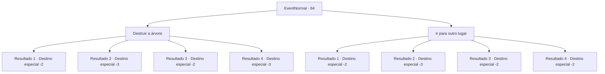

# Eventos normais · 64

[Índice da tabela](index.md) · [Índice geral](../index.md)

ID: `pt:EventNormal:64` · Fonte: `EventNormal4` · Versão: 1.2.47.

Mapeamento estático dos arquivos; a disponibilidade e a execução dependem do estado da run.

## Texto do evento

*Sem texto no arquivo.*

## Dados de entrada

```json
{
  "id": 64,
  "grade": 1,
  "place": "",
  "required": ""
}
```

## Mapa das escolhas



## Escolhas e resultados

### Escolha 1

Destruir a árvore

Requisitos e outros campos da escolha:

```json
{
  "required": ""
}
```

#### Resultado 1.1

Você decide destruir a árvore. Você a golpeia o mais forte possível, mas ela nem se mexe. Quando você se afasta para recuperar o fôlego, um raio atinge a árvore. A árvore gigante instantâneamente pega fogo, então você sai o mais rápido dali.

Continuação registrada: [Destino especial `-2`](../destinos-especiais.md).

```json
{
  "required": "1_1_2",
  "chance": "10",
  "nextEvent": -2,
  "type": 1,
  "reward": "0_1_-1|0_2_1"
}
```

#### Resultado 1.2

Você decide destruir a árvore. Você a golpeia o mais forte possível, mas ela nem se mexe. Quando você se afasta para recuperar o fôlego, um raio atinge a árvore. A árvore gigante instantâneamente pega fogo, e você cai no chão vítima de um ataque cardíaco.

Continuação registrada: [Destino especial `-3`](../destinos-especiais.md).

```json
{
  "required": "2_1_2",
  "chance": "10",
  "nextEvent": -3,
  "type": 1,
  "reward": "0_1_-1"
}
```

#### Resultado 1.3

Você decide destruir a árvore. Você a golpeia o mais forte possível, e mais folhas caem cortando sua pele e roupas. Porém você continua batendo na árvore, e quando ela finalmente cai, seu corpo está coberto de sangue A chuva limpa seu sangue. Seu corpo inteiro arde. Você segue o seu caminho.

Continuação registrada: [Destino especial `-2`](../destinos-especiais.md).

```json
{
  "required": "1_0_2",
  "chance": "1|0_5_1",
  "nextEvent": -2,
  "type": 0,
  "reward": "0_0_-1|0_2_1|5_44_1"
}
```

#### Resultado 1.4

Você decide destruir a árvore. Você a golpeia o mais forte possível, e mais folhas caem cortando sua pele e roupas. Porém você continua batendo na árvore, e quando ela finalmente cai, seu corpo está coberto de sangue. Você cai no chão por perder muito sangue.

Continuação registrada: [Destino especial `-3`](../destinos-especiais.md).

```json
{
  "required": "2_0_2",
  "chance": "1|0_5_1",
  "nextEvent": -3,
  "type": 0,
  "reward": "0_0_-1|0_2_1"
}
```

### Escolha 2

Ir para outro lugar

Requisitos e outros campos da escolha:

```json
{
  "required": ""
}
```

#### Resultado 2.1

Você decide continuar sua jornada pela chuva. Mas o vento e a chuva são muito fortes para você. Você fica com hipotermia e estremece enquanto se arrasta.

Continuação registrada: [Destino especial `-2`](../destinos-especiais.md).

```json
{
  "required": "1_0_2",
  "chance": "5",
  "nextEvent": -2,
  "type": 2,
  "reward": "0_0_-1|0_2_1"
}
```

#### Resultado 2.2

Você decide continuar sua jornada pela chuva. Mas o vento e a chuva são muito fortes para você. Você fica com hipotermia e seu rosto fica azul. Você desmaia e morre logo depois.

Continuação registrada: [Destino especial `-3`](../destinos-especiais.md).

```json
{
  "required": "2_0_2",
  "chance": "5",
  "nextEvent": -3,
  "type": 2,
  "reward": "0_0_-1"
}
```

#### Resultado 2.3

Você decide continuar sua jornada pela chuva. Mas logo para de chover. Você encara a árvore uma vez e segue em frente.

Continuação registrada: [Destino especial `-2`](../destinos-especiais.md).

```json
{
  "required": "",
  "chance": "10",
  "nextEvent": -2,
  "type": 2,
  "reward": "0_2_1"
}
```

#### Resultado 2.4

Você se arrasta na chuva. Está bem frio, mas isso não te incomoda.

Continuação registrada: [Destino especial `-2`](../destinos-especiais.md).

```json
{
  "required": "",
  "chance": "1|0_13_1",
  "nextEvent": -2,
  "type": 2,
  "reward": "0_2_1"
}
```

## Referências que chegam a este evento

- [Evento 63 · escolha 1 · resultado 1](0063.md#escolha-1)
