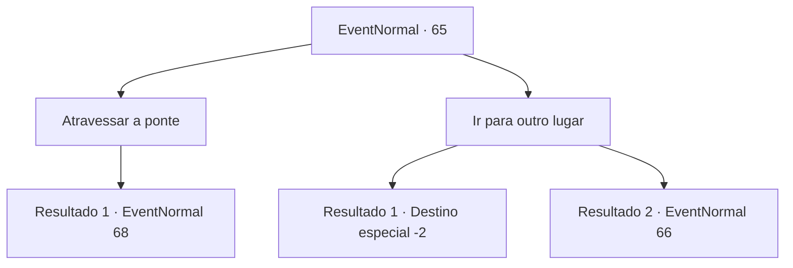

# Eventos normais · 65

[Índice da tabela](index.md) · [Índice geral](../index.md)

ID: `pt:EventNormal:65` · Fonte: `EventNormal4` · Versão: 1.2.47.

Mapeamento estático dos arquivos; a disponibilidade e a execução dependem do estado da run.

## Texto do evento

Você encontra uma longa ponte sobre um desfiladeiro. Acabou de parar de chover e uma névoa úmida cobre a montanha. A ponte é feita de pranchas de madeira amarradas com corda grossa e parece resistente o suficiente para uma pessoa. 

## Dados de entrada

```json
{
  "id": 65,
  "grade": 1,
  "place": "",
  "required": ""
}
```

## Mapa das escolhas



## Escolhas e resultados

### Escolha 1

Atravessar a ponte

Requisitos e outros campos da escolha:

```json
{
  "required": ""
}
```

#### Resultado 1.1

 A ponte range a cada passo. Você atravessa três quartos dela, então uma mulher aparece na sua frente. Ela pega uma espada e fala. 

 "Você aí! Jogue o saco para este lado, ou eu vou cortar a corda!"


Continuação registrada: [Evento 68](0068.md) na mesma tabela.

```json
{
  "required": "",
  "chance": "1",
  "nextEvent": 68,
  "type": 2,
  "reward": ""
}
```

### Escolha 2

Ir para outro lugar

Requisitos e outros campos da escolha:

```json
{
  "required": ""
}
```

#### Resultado 2.1

Você volta, escolhendo não atravessar a ponte.

Continuação registrada: [Destino especial `-2`](../destinos-especiais.md).

```json
{
  "required": "",
  "chance": "1",
  "nextEvent": -2,
  "type": 2,
  "reward": ""
}
```

#### Resultado 2.2

Você volta, escolhendo não atravessar a ponte. Momentos depois, você encontra um grupo de bandidos bloqueando seu caminho. 

 "Você está em nosso distrito. A taxa é 10 ouros."

 Eles sorriem tortuosamente, com punhais na mão.

Continuação registrada: [Evento 66](0066.md) na mesma tabela.

```json
{
  "required": "",
  "chance": "2",
  "nextEvent": 66,
  "type": 2,
  "reward": ""
}
```

## Referências que chegam a este evento

Nenhum `nextEvent` positivo da mesma tabela aponta para este nó. Isso não prova que seja inacessível: sorteio e estado de história podem selecioná-lo.

