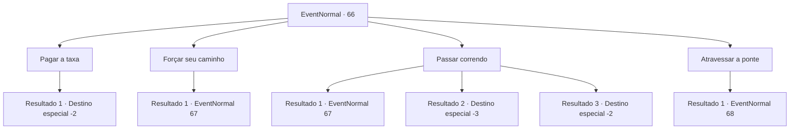

# Eventos normais · 66

[Índice da tabela](index.md) · [Índice geral](../index.md)

ID: `pt:EventNormal:66` · Fonte: `EventNormal4` · Versão: 1.2.47.

Mapeamento estático dos arquivos; a disponibilidade e a execução dependem do estado da run.

## Texto do evento

*Sem texto no arquivo.*

## Dados de entrada

```json
{
  "id": 66,
  "grade": 1,
  "place": "",
  "required": ""
}
```

## Mapa das escolhas



## Escolhas e resultados

### Escolha 1

Pagar a taxa

Requisitos e outros campos da escolha:

```json
{
  "required": "1_4_10"
}
```

#### Resultado 1.1

Você paga a taxa. Eles sorriem e deixam você passar.

Continuação registrada: [Destino especial `-2`](../destinos-especiais.md).

```json
{
  "required": "",
  "chance": "1",
  "nextEvent": -2,
  "type": 2,
  "reward": "0_4_-10|0_2_1"
}
```

### Escolha 2

Forçar seu caminho

Requisitos e outros campos da escolha:

```json
{
  "required": ""
}
```

#### Resultado 2.1

Você decide fazê-los deixar você passar à força. Você saca sua arma e eles o cercam, sacando a deles.

Continuação registrada: [Evento 67](0067.md) na mesma tabela.

```json
{
  "required": "",
  "chance": "1",
  "nextEvent": 67,
  "type": 2,
  "reward": "6_3_2",
  "place": 1
}
```

### Escolha 3

Passar correndo

Requisitos e outros campos da escolha:

```json
{
  "required": ""
}
```

#### Resultado 3.1

Você tenta passar por eles, mas tropeça no pé de um bandido. Você rola no chão e eles dão uma boa risada. Então eles cercam você, com armas em punho.

Continuação registrada: [Evento 67](0067.md) na mesma tabela.

```json
{
  "required": "1_0_2",
  "chance": "9",
  "nextEvent": 67,
  "type": 1,
  "reward": "6_3_2|0_0_-1",
  "place": 1
}
```

#### Resultado 3.2

Você tenta passar por eles, mas tropeça no pé de um bandido. Você rola no chão, bate a cabeça em uma pedra e perde a consciência.

Continuação registrada: [Destino especial `-3`](../destinos-especiais.md).

```json
{
  "required": "2_0_2",
  "chance": "9",
  "nextEvent": -3,
  "type": 1,
  "reward": "0_0_-1"
}
```

#### Resultado 3.3

Você passa rapidamente por eles antes que eles possam fazer qualquer coisa. <link=shake>

 "Ei, espere!"

</link> Atordoados, eles se levantam e olham. Então eles começam a vir atrás de você. Mas eles não te alcançam.

Continuação registrada: [Destino especial `-2`](../destinos-especiais.md).

```json
{
  "required": "",
  "chance": "1|0_6_1",
  "nextEvent": -2,
  "type": 0,
  "reward": "0_1_1|0_2_2"
}
```

### Escolha 4

Atravessar a ponte

Requisitos e outros campos da escolha:

```json
{
  "required": ""
}
```

#### Resultado 4.1

Você volta por onde veio, em direção à ponte. Os bandidos não perseguiram você. Sem fôlego, você tenta atravessar a ponte, quando uma mulher aparece do outro lado. Ela pega uma espada e fala. 

 "Você aí! Jogue o saco para este lado, ou eu vou cortar a corda!"


Continuação registrada: [Evento 68](0068.md) na mesma tabela.

```json
{
  "required": "",
  "chance": "1",
  "nextEvent": 68,
  "type": 2,
  "reward": ""
}
```

## Referências que chegam a este evento

- [Evento 65 · escolha 2 · resultado 2](0065.md#escolha-2)
