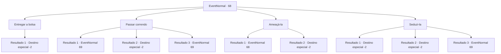

# Eventos normais · 68

[Índice da tabela](index.md) · [Índice geral](../index.md)

ID: `pt:EventNormal:68` · Fonte: `EventNormal4` · Versão: 1.2.47.

Mapeamento estático dos arquivos; a disponibilidade e a execução dependem do estado da run.

## Texto do evento

*Sem texto no arquivo.*

## Dados de entrada

```json
{
  "id": 68,
  "grade": 1,
  "place": "",
  "required": "18_32_1|18_32_2"
}
```

## Mapa das escolhas



## Escolhas e resultados

### Escolha 1

Entregar a bolsa

Requisitos e outros campos da escolha:

```json
{
  "required": ""
}
```

#### Resultado 1.1

Você não tem escolha a não ser tirar sua bolsa e jogar para ela. Ela ri alto enquanto fala. 

 "Hahahaha! Obrigado pela sua cooperação!"

 Ela pega sua bolsa de ouro. E então foge.

Continuação registrada: [Destino especial `-2`](../destinos-especiais.md).

```json
{
  "required": "",
  "chance": "1",
  "nextEvent": -2,
  "type": 2,
  "reward": "0_4_-50|0_2_1"
}
```

### Escolha 2

Passar correndo

Requisitos e outros campos da escolha:

```json
{
  "required": ""
}
```

#### Resultado 2.1

Você finge considerar a oferta dela antes de correr a toda velocidade. Ela não consegue cortar a corda a tempo enquanto você passa correndo. 

 "Ah...Uh..."

 A mulher não consegue esconder seu constrangimento enquanto grita. <link=shake>

 "Le...Levante-se! Meus soldados!"

</link> E com isso, um esqueleto sobe a terra sob seus pés. Ele imediatamente começa a balançar sua espada em você.

Continuação registrada: [Evento 69](0069.md) na mesma tabela.

```json
{
  "required": "21_10_1",
  "chance": "1|0_6_1",
  "nextEvent": 69,
  "type": 0,
  "reward": "6_0_12",
  "place": 1
}
```

#### Resultado 2.2

Você finge considerar a oferta dela antes de correr a toda velocidade. Mas a mulher é mais rápida com a corda. A ponte desmorona e as profundezas do desfiladeiro engolem você inteiro.

Continuação registrada: [Destino especial `-2`](../destinos-especiais.md).

```json
{
  "required": "21_10_1",
  "chance": "10",
  "nextEvent": -2,
  "type": 1,
  "reward": "0_0_-1|0_2_1"
}
```

#### Resultado 2.3

Você finge considerar a oferta dela antes de correr a toda velocidade. Mas a mulher é mais rápido com a corda. A ponte foi quebrada, mas você escalou pelo ar e chegou ao outro lado. 

 "Ah...Uh..."

 A mulher não consegue esconder a vergonha enquanto grita. <link=shake>

 "Le...Levantem! Meus soldados!"

</link> E com aquilo, um esqueleto escala para fora da terra abaixo dos seus pés. Ele imediatamente começa a sacudir a espada em sua direção.

Continuação registrada: [Evento 69](0069.md) na mesma tabela.

```json
{
  "required": "20_10_1",
  "chance": "1",
  "nextEvent": 69,
  "type": 0,
  "reward": "6_0_12",
  "place": 1
}
```

### Escolha 3

Ameaçá-la

Requisitos e outros campos da escolha:

```json
{
  "required": "5_32_0"
}
```

#### Resultado 3.1

Você ameaça matá-la. Mas ela zomba de você. 

 "Heh. Pare de brincar e entregue a bolsa!"


Continuação registrada: [Evento 68](0068.md) na mesma tabela.

```json
{
  "required": "",
  "chance": "10",
  "nextEvent": 68,
  "type": 1,
  "reward": "5_32_1"
}
```

#### Resultado 3.2

Você ameaça matá-la. Funciona! Suas mãos e pernas começam a tremer. 

 "V-Volte! Hum..!"

 Parece que ela viu uma barata gigante. Consumida pelo medo, ela larga a espada e corre.

Continuação registrada: [Destino especial `-2`](../destinos-especiais.md).

```json
{
  "required": "",
  "chance": "1|0_12_1",
  "nextEvent": -2,
  "type": 0,
  "reward": "0_2_1|3_12_1"
}
```

### Escolha 4

Seduzi-la

Requisitos e outros campos da escolha:

```json
{
  "required": "5_32_0"
}
```

#### Resultado 4.1

Você tenta seduzi-la, mas falha miseravelmente. Ela zomba e vai para a corda. As profundezas do desfiladeiro engolem você inteiro.

Continuação registrada: [Destino especial `-2`](../destinos-especiais.md).

```json
{
  "required": "21_10_1",
  "chance": "13",
  "nextEvent": -2,
  "type": 1,
  "reward": "0_0_-1|0_1_-1|5_32_1|0_2_1"
}
```

#### Resultado 4.2

Ela hesita por um momento antes de largar sua espada. Então ela fala enquanto seu rosto cora. <link=wave>

 "Você...pode passar..."

</link> Você cruza a ponte com segurança com 'ajuda' dela. Ela também te dá ouro.

Continuação registrada: [Destino especial `-2`](../destinos-especiais.md).

```json
{
  "required": "11_0_0",
  "chance": "1|0_12_1",
  "nextEvent": -2,
  "type": 0,
  "reward": "0_2_1|0_4_1|5_32_2"
}
```

#### Resultado 4.3

Você tenta seduzir ela, mas falha miseravelmente. Ela zomba e vai em direção à corda. A ponte foi quebrada, mas você escalou pelo ar e chegou ao outro lado. 

 "Ah...Uh..."

 A mulher não consegue esconder a vergonha enquanto grita. <link=shake>

 "Le...Levantem! Meus soldados!"

</link> E com aquilo, um esqueleto escala para fora da terra abaixo abaixo dos seus pés. Ele imediatamente começa a sacudir a espada em sua direção.

Continuação registrada: [Evento 69](0069.md) na mesma tabela.

```json
{
  "required": "20_10_1",
  "chance": "13",
  "nextEvent": 69,
  "type": 1,
  "reward": "6_0_12",
  "place": 1
}
```

## Referências que chegam a este evento

- [Evento 65 · escolha 1 · resultado 1](0065.md#escolha-1)
- [Evento 66 · escolha 4 · resultado 1](0066.md#escolha-4)
- [Evento 68 · escolha 3 · resultado 1](0068.md#escolha-3)
