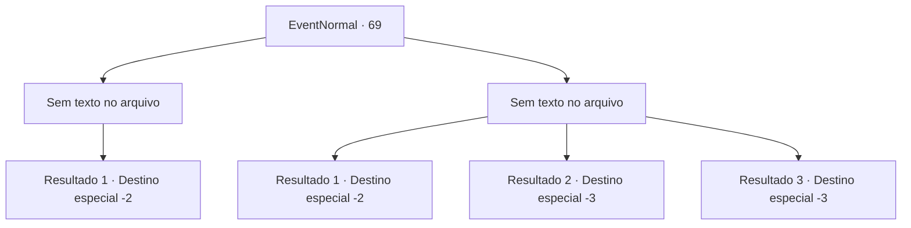

# Eventos normais · 69

[Índice da tabela](index.md) · [Índice geral](../index.md)

ID: `pt:EventNormal:69` · Fonte: `EventNormal4` · Versão: 1.2.47.

Mapeamento estático dos arquivos; a disponibilidade e a execução dependem do estado da run.

## Texto do evento

*Sem texto no arquivo.*

## Dados de entrada

```json
{
  "id": 69,
  "grade": 1,
  "place": "//승",
  "required": ""
}
```

## Mapa das escolhas



## Escolhas e resultados

### Escolha 1

*Sem texto no arquivo; o papel dessa opção depende da interface do jogo.*

Requisitos e outros campos da escolha:

```json
{
  "required": ""
}
```

#### Resultado 1.1

O Esqueleto não é páreo para você. Ele perde a força e desmorona, e a mulher foge. Você sacode a poeira de osso em suas roupas e depois segue em frente.

Continuação registrada: [Destino especial `-2`](../destinos-especiais.md).

```json
{
  "required": "",
  "chance": "1",
  "nextEvent": -2,
  "type": 2,
  "reward": ""
}
```

### Escolha 2

*Sem texto no arquivo; o papel dessa opção depende da interface do jogo.*

Requisitos e outros campos da escolha:

```json
{
  "required": ""
}
```

#### Resultado 2.1

Esqueleto bate em você e você cai. Summoner vem até você e procura a bolsa de ouro. 

 "Eu gostaria que você tivesse me dado"

 Ela rouba seu ouro e depois foge.

Continuação registrada: [Destino especial `-2`](../destinos-especiais.md).

```json
{
  "required": "1_0_2|1_1_2",
  "chance": "1",
  "nextEvent": -2,
  "type": 2,
  "reward": "0_0_-1|0_1_-1|0_4_-50"
}
```

#### Resultado 2.2

Esqueletos batem em você e sua mente escurece.

Continuação registrada: [Destino especial `-3`](../destinos-especiais.md).

```json
{
  "required": "2_0_2",
  "chance": "1",
  "nextEvent": -3,
  "type": 2,
  "reward": "0_0_-1|0_1_-1|0_4_-50"
}
```

#### Resultado 2.3

Esqueletos batem em você e sua mente escurece.

Continuação registrada: [Destino especial `-3`](../destinos-especiais.md).

```json
{
  "required": "2_1_2",
  "chance": "1",
  "nextEvent": -3,
  "type": 2,
  "reward": "0_0_-1|0_1_-1|0_4_-50"
}
```

## Referências que chegam a este evento

- [Evento 68 · escolha 2 · resultado 1](0068.md#escolha-2)
- [Evento 68 · escolha 2 · resultado 3](0068.md#escolha-2)
- [Evento 68 · escolha 4 · resultado 3](0068.md#escolha-4)
