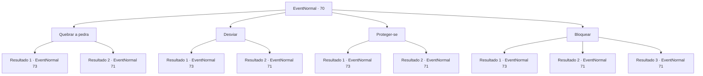

# Eventos normais · 70

[Índice da tabela](index.md) · [Índice geral](../index.md)

ID: `pt:EventNormal:70` · Fonte: `EventNormal4` · Versão: 1.2.47.

Mapeamento estático dos arquivos; a disponibilidade e a execução dependem do estado da run.

## Texto do evento

Você está escalando uma montanha rochosa. De repente, um estrondo terrível vem do alto. Você olha para cima e vê uma rocha descendo direto para a sua cabeça.

## Dados de entrada

```json
{
  "id": 70,
  "grade": 1,
  "place": "",
  "required": "1_2_50"
}
```

## Mapa das escolhas



## Escolhas e resultados

### Escolha 1

Quebrar a pedra

Requisitos e outros campos da escolha:

```json
{
  "required": ""
}
```

#### Resultado 1.1

Você tenta esmagar a pedra, mas falha. Ela te esmaga enquanto rola ladeira abaixo. Você sente uma dor extrema, provavelmente por causa dos ossos quebrados. Então um troll desce correndo de onde veio a pedra.

Continuação registrada: [Evento 73](0073.md) na mesma tabela.

```json
{
  "required": "",
  "chance": "18",
  "nextEvent": 73,
  "type": 1,
  "reward": "0_0_-1|6_0_9",
  "place": 5
}
```

#### Resultado 1.2

Você balança sua arma na pedra. Ela se quebra em pedaços e se espalha para baixo. Quando você olha para trás de onde veio, um troll rapidamente se esconde de você.

Continuação registrada: [Evento 71](0071.md) na mesma tabela.

```json
{
  "required": "",
  "chance": "1|0_5_1",
  "nextEvent": 71,
  "type": 0,
  "reward": ""
}
```

### Escolha 2

Desviar

Requisitos e outros campos da escolha:

```json
{
  "required": ""
}
```

#### Resultado 2.1

Você tenta se esquivar da pedra que chega, mas falha. Esmaga você enquanto rola ladeira abaixo. Você sente uma dor extrema, provavelmente por causa dos ossos quebrados. Então um troll desce correndo de onde veio a pedra. Ele sorri e borbulha ao se aproximar de você.

Continuação registrada: [Evento 73](0073.md) na mesma tabela.

```json
{
  "required": "",
  "chance": "12",
  "nextEvent": 73,
  "type": 1,
  "reward": "0_0_-1|6_0_9",
  "place": 5
}
```

#### Resultado 2.2

Você rapidamente se esquiva da pedra que se aproxima. Ao olhar para cima de onde ela veio, um troll rapidamente se esconde de você.

Continuação registrada: [Evento 71](0071.md) na mesma tabela.

```json
{
  "required": "",
  "chance": "1|0_6_1",
  "nextEvent": 71,
  "type": 0,
  "reward": ""
}
```

### Escolha 3

Proteger-se

Requisitos e outros campos da escolha:

```json
{
  "required": ""
}
```

#### Resultado 3.1

Você se contorce em uma fenda entre as rochas. Mas você não consegue prever a trajetória da pedra, e ela o esmaga de qualquer maneira. Você sente uma dor extrema, provavelmente por causa de ossos quebrados. Então um troll desce correndo de onde veio a pedra. Ele sorri e borbulha ao se aproximar de você.

Continuação registrada: [Evento 73](0073.md) na mesma tabela.

```json
{
  "required": "",
  "chance": "10",
  "nextEvent": 73,
  "type": 1,
  "reward": "0_0_-1|6_0_9",
  "place": 5
}
```

#### Resultado 3.2

Você prevê instantaneamente a trajetória da pedra e se esquiva com sucesso. Quando você olha para trás de onde veio, um troll rapidamente se esconde de você.

Continuação registrada: [Evento 71](0071.md) na mesma tabela.

```json
{
  "required": "",
  "chance": "1|0_7_1",
  "nextEvent": 71,
  "type": 0,
  "reward": ""
}
```

### Escolha 4

Bloquear

Requisitos e outros campos da escolha:

```json
{
  "required": "20_9_2"
}
```

#### Resultado 4.1

Você tenta bloquear a pedra que chega, mas falha. Ela esmaga você enquanto rola ladeira abaixo. Você sente uma dor extrema, provavelmente por causa dos ossos quebrados. Então um troll desce correndo de onde veio a pedra. Ele sorri e borbulha ao se aproximar de você.

Continuação registrada: [Evento 73](0073.md) na mesma tabela.

```json
{
  "required": "",
  "chance": "30",
  "nextEvent": 73,
  "type": 1,
  "reward": "0_0_-1|6_0_9",
  "place": 5
}
```

#### Resultado 4.2

Você bloqueia a pedra que chega. Ela se quebra em pedaços e se espalha para baixo. Quando você olha para trás de onde veio, um troll rapidamente se esconde de você.

Continuação registrada: [Evento 71](0071.md) na mesma tabela.

```json
{
  "required": "",
  "chance": "1|0_5_1",
  "nextEvent": 71,
  "type": 0,
  "reward": ""
}
```

#### Resultado 4.3

Você bloqueia a pedra que chega. Ela se quebra em pedaços e se espalha para baixo. Quando você olha para trás de onde veio, um troll rapidamente se esconde de você.

Continuação registrada: [Evento 71](0071.md) na mesma tabela.

```json
{
  "required": "",
  "chance": "1|0_13_1",
  "nextEvent": 71,
  "type": 0,
  "reward": ""
}
```

## Referências que chegam a este evento

Nenhum `nextEvent` positivo da mesma tabela aponta para este nó. Isso não prova que seja inacessível: sorteio e estado de história podem selecioná-lo.

