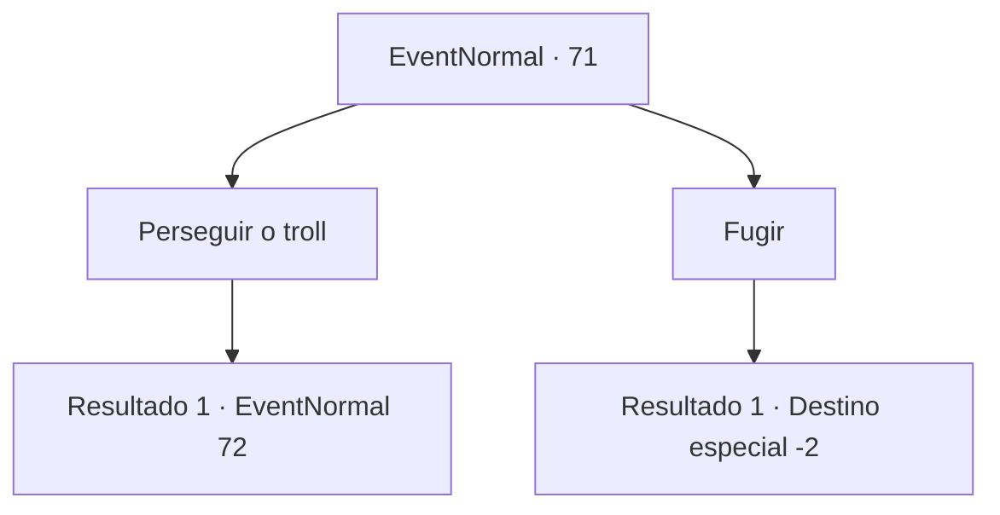

# Eventos normais · 71

[Índice da tabela](index.md) · [Índice geral](../index.md)

ID: `pt:EventNormal:71` · Fonte: `EventNormal4` · Versão: 1.2.47.

Mapeamento estático dos arquivos; a disponibilidade e a execução dependem do estado da run.

## Texto do evento

*Sem texto no arquivo.*

## Dados de entrada

```json
{
  "id": 71,
  "grade": 1,
  "place": "",
  "required": ""
}
```

## Mapa das escolhas



## Escolhas e resultados

### Escolha 1

Perseguir o troll

Requisitos e outros campos da escolha:

```json
{
  "required": ""
}
```

#### Resultado 1.1

Você se aproxima do esconderijo do troll. Assim que o troll te vê, começa a recuar.

Continuação registrada: [Evento 72](0072.md) na mesma tabela.

```json
{
  "required": "",
  "chance": "1",
  "nextEvent": 72,
  "type": 2,
  "reward": "0_2_1"
}
```

### Escolha 2

Fugir

Requisitos e outros campos da escolha:

```json
{
  "required": ""
}
```

#### Resultado 2.1

Você corre do troll.

Continuação registrada: [Destino especial `-2`](../destinos-especiais.md).

```json
{
  "required": "",
  "chance": "1",
  "nextEvent": -2,
  "type": 2,
  "reward": "0_2_1"
}
```

## Referências que chegam a este evento

- [Evento 70 · escolha 1 · resultado 2](0070.md#escolha-1)
- [Evento 70 · escolha 2 · resultado 2](0070.md#escolha-2)
- [Evento 70 · escolha 3 · resultado 2](0070.md#escolha-3)
- [Evento 70 · escolha 4 · resultado 2](0070.md#escolha-4)
- [Evento 70 · escolha 4 · resultado 3](0070.md#escolha-4)
