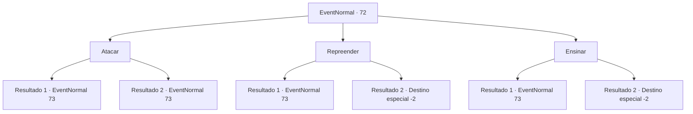

# Eventos normais · 72

[Índice da tabela](index.md) · [Índice geral](../index.md)

ID: `pt:EventNormal:72` · Fonte: `EventNormal4` · Versão: 1.2.47.

Mapeamento estático dos arquivos; a disponibilidade e a execução dependem do estado da run.

## Texto do evento

*Sem texto no arquivo.*

## Dados de entrada

```json
{
  "id": 72,
  "grade": 1,
  "place": "",
  "required": ""
}
```

## Mapa das escolhas



## Escolhas e resultados

### Escolha 1

Atacar

Requisitos e outros campos da escolha:

```json
{
  "required": ""
}
```

#### Resultado 1.1

Você ataca o troll assustado. Mas ele facilmente apara seu ataque e vem pra cima de você.

Continuação registrada: [Evento 73](0073.md) na mesma tabela.

```json
{
  "required": "",
  "chance": "15",
  "nextEvent": 73,
  "type": 1,
  "reward": "6_3_9",
  "place": 5
}
```

#### Resultado 1.2

Você ataca o troll assustado. Você o acerta em seu ponto fraco e o troll ataca você, gritando de dor.

Continuação registrada: [Evento 73](0073.md) na mesma tabela.

```json
{
  "required": "",
  "chance": "1|0_5_1",
  "nextEvent": 73,
  "type": 0,
  "reward": "6_2_9",
  "place": 5
}
```

### Escolha 2

Repreender

Requisitos e outros campos da escolha:

```json
{
  "required": ""
}
```

#### Resultado 2.1

Você repreende o troll por empurrar a pedra. Ele se ofende com suas palavras e vem em sua direção.

Continuação registrada: [Evento 73](0073.md) na mesma tabela.

```json
{
  "required": "",
  "chance": "10",
  "nextEvent": 73,
  "type": 1,
  "reward": "6_0_9",
  "place": 5
}
```

#### Resultado 2.2

Você repreende o troll por empurrar a pedra. Você o sobrecarrega com seu carisma. 

 "Oooh...Ghoooh..."

 O troll coça a cabeça e olha para baixo se desculpando. Em seguida, ele se transforma e foge.

Continuação registrada: [Destino especial `-2`](../destinos-especiais.md).

```json
{
  "required": "",
  "chance": "1|0_12_1",
  "nextEvent": -2,
  "type": 0,
  "reward": "0_3_3|0_2_1|0_4_50"
}
```

### Escolha 3

Ensinar

Requisitos e outros campos da escolha:

```json
{
  "required": ""
}
```

#### Resultado 3.1

Você tenta ensinar o troll a não jogar pedras nos transeuntes. Mas ele não ouve uma palavra que você diz. Ele responde com um balanço de sua clava.

Continuação registrada: [Evento 73](0073.md) na mesma tabela.

```json
{
  "required": "",
  "chance": "10",
  "nextEvent": 73,
  "type": 1,
  "reward": "6_0_9",
  "place": 5
}
```

#### Resultado 3.2

Você tenta ensinar o troll a não jogar pedras nos transeuntes. Ele balança a cabeça enquanto você fala. 

 "Oooh...Ghoooh..."

 Em seguida, ele se transforma e foge.

Continuação registrada: [Destino especial `-2`](../destinos-especiais.md).

```json
{
  "required": "",
  "chance": "1|0_14_1",
  "nextEvent": -2,
  "type": 0,
  "reward": "0_3_3|0_2_1|0_4_50"
}
```

## Referências que chegam a este evento

- [Evento 71 · escolha 1 · resultado 1](0071.md#escolha-1)
