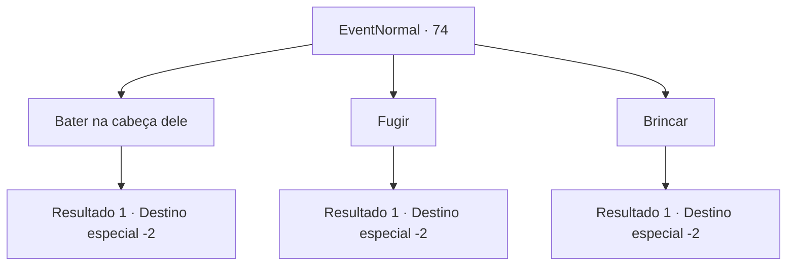

# Eventos normais · 74

[Índice da tabela](index.md) · [Índice geral](../index.md)

ID: `pt:EventNormal:74` · Fonte: `EventNormal4` · Versão: 1.2.47.

Mapeamento estático dos arquivos; a disponibilidade e a execução dependem do estado da run.

## Texto do evento

|drawing_town|Você está passando por uma cidade. Você conhece um garoto que parece ser o líder seus amigos. Ele fala com você com arrogância. 

 "Você! Aventureiro! Venha aqui e brinque com a gente!"

 Ele está vestido de seda, ao contrário das outras crianças. Ele provavelmente pertence a uma família rica e poderosa. Seus amigos obedecem a todas as suas necessidades, usando sorrisos servis.

## Dados de entrada

```json
{
  "id": 74,
  "grade": 1,
  "place": "",
  "required": "5_45_0"
}
```

## Mapa das escolhas



## Escolhas e resultados

### Escolha 1

Bater na cabeça dele

Requisitos e outros campos da escolha:

```json
{
  "required": ""
}
```

#### Resultado 1.1

Você bateu no menino de seda na cabeça. Chocado, ele congela por um momento antes de cair no choro. As crianças olham para você, de olhos arregalados. 

 "AHHHH! Você... você! Você vai pagar por isso!"

 As crianças se dispersam e você segue em frente.

Continuação registrada: [Destino especial `-2`](../destinos-especiais.md).

```json
{
  "required": "",
  "chance": "1",
  "nextEvent": -2,
  "type": 2,
  "reward": "0_2_1|0_3_-1|0_1_1|5_45_1"
}
```

### Escolha 2

Fugir

Requisitos e outros campos da escolha:

```json
{
  "required": ""
}
```

#### Resultado 2.1

Você foge das crianças. Eles correm atrás de você, mas logo desistem.

Continuação registrada: [Destino especial `-2`](../destinos-especiais.md).

```json
{
  "required": "",
  "chance": "1",
  "nextEvent": -2,
  "type": 2,
  "reward": "0_2_1"
}
```

### Escolha 3

Brincar

Requisitos e outros campos da escolha:

```json
{
  "required": ""
}
```

#### Resultado 3.1

Nenhuma palavra pode descrever os horrores que você enfrenta. É pior do que brincar com os sobrinhos nas férias. As crianças te atormentam até o pôr do sol. 

 "Você é engraçado, aventureiro. Até a próxima!"

 O menino rico sai com seus amigos.

Continuação registrada: [Destino especial `-2`](../destinos-especiais.md).

```json
{
  "required": "",
  "chance": "1",
  "nextEvent": -2,
  "type": 2,
  "reward": "0_1_-1|0_4_10|5_45_4|0_2_1"
}
```

## Referências que chegam a este evento

Nenhum `nextEvent` positivo da mesma tabela aponta para este nó. Isso não prova que seja inacessível: sorteio e estado de história podem selecioná-lo.

