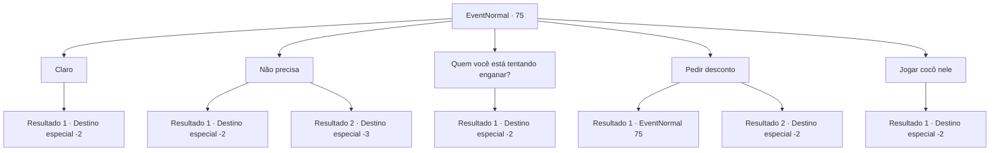

# Eventos normais · 75

[Índice da tabela](index.md) · [Índice geral](../index.md)

ID: `pt:EventNormal:75` · Fonte: `EventNormal4` · Versão: 1.2.47.

Mapeamento estático dos arquivos; a disponibilidade e a execução dependem do estado da run.

## Texto do evento

|drawing_town| Você está visitando algumas lojas quando uma criança grita com você. 

 "Aventureiro! Você tem cocô no sapato! Posso limpar para você?"

 O garoto está segurando um pano e uma garrafa de líquido de aparência suspeita. Presumivelmente, são ferramentas de limpeza de calçados. Você olha para o seu sapato e, de fato, um deles tem cocô de cachorro nele.

## Dados de entrada

```json
{
  "id": 75,
  "grade": 1,
  "place": "",
  "required": "5_525_0"
}
```

## Mapa das escolhas



## Escolhas e resultados

### Escolha 1

Claro

Requisitos e outros campos da escolha:

```json
{
  "required": "1_4_5"
}
```

#### Resultado 1.1

O garoto responde encantado e limpa seus sapatos com muito cuidado. Você entrega a ele 5 ouros e segue seu caminho.

Continuação registrada: [Destino especial `-2`](../destinos-especiais.md).

```json
{
  "required": "",
  "chance": "1",
  "nextEvent": -2,
  "type": 2,
  "reward": "0_4_-5|0_2_1"
}
```

### Escolha 2

Não precisa

Requisitos e outros campos da escolha:

```json
{
  "required": ""
}
```

#### Resultado 2.1

Você recusa a oferta do garoto e limpa o cocô sozinho. O garoto tira o resto do cocô do bolso de trás, joga em você e sai correndo.

Continuação registrada: [Destino especial `-2`](../destinos-especiais.md).

```json
{
  "required": "1_1_2",
  "chance": "1",
  "nextEvent": -2,
  "type": 2,
  "reward": "5_42_0|0_1_-1|0_2_1|5_525_1"
}
```

#### Resultado 2.2

Você recusa a oferta do garoto e limpa o cocô sozinho. O garoto tira o resto do cocô do bolso de trás, joga em você e sai correndo. Você já está perto de um colapso, e o cocô foi o golpe final. Você desmaia quando alguém te pega.

Continuação registrada: [Destino especial `-3`](../destinos-especiais.md).

```json
{
  "required": "2_1_2",
  "chance": "1",
  "nextEvent": -3,
  "type": 2,
  "reward": "5_42_0|0_1_-1"
}
```

### Escolha 3

Quem você está tentando enganar?

Requisitos e outros campos da escolha:

```json
{
  "required": "1_14_12"
}
```

#### Resultado 3.1

Você dá uma boa olhada no garoto mais limpo. Ele tem manchas de cocô na manga da camisa e na mão. Ele está mentindo para você. Você o repreende e ele foge para um beco estreito com o rosto avermelhado.

Continuação registrada: [Destino especial `-2`](../destinos-especiais.md).

```json
{
  "required": "",
  "chance": "1",
  "nextEvent": -2,
  "type": 2,
  "reward": "0_2_2|0_1_1|5_525_1"
}
```

### Escolha 4

Pedir desconto

Requisitos e outros campos da escolha:

```json
{
  "required": "1_4_4|5_42_0"
}
```

#### Resultado 4.1

O garoto balança a cabeça tristemente. Você não consegue pechinchar um preço mais barato.

Continuação registrada: [Evento 75](0075.md) na mesma tabela.

```json
{
  "required": "",
  "chance": "5",
  "nextEvent": 75,
  "type": 1,
  "reward": "5_42_1|0_2_1"
}
```

#### Resultado 4.2

O garoto pensa sobre isso, e então concorda. 

 "Certo. Vou limpá-los por 4 ouros, 20% de desconto!"

 Ele limpa seus sapatos com muito cuidado. Você entrega a ele 4 ouros e segue seu caminho.

Continuação registrada: [Destino especial `-2`](../destinos-especiais.md).

```json
{
  "required": "",
  "chance": "1|0_12_1",
  "nextEvent": -2,
  "type": 0,
  "reward": "0_2_1|0_4_-4|5_42_0"
}
```

### Escolha 5

Jogar cocô nele

Requisitos e outros campos da escolha:

```json
{
  "required": "2_3_0"
}
```

#### Resultado 5.1

Você joga cocô no garoto mais limpo. 

 "Ahh!! droga..!!"

 A criança foge dos respingos cocô. Você esfrega os sapatos na terra e segue seu caminho.

Continuação registrada: [Destino especial `-2`](../destinos-especiais.md).

```json
{
  "required": "",
  "chance": "1",
  "nextEvent": -2,
  "type": 2,
  "reward": "0_1_1|0_3_-1|5_525_1"
}
```

## Referências que chegam a este evento

- [Evento 75 · escolha 4 · resultado 1](0075.md#escolha-4)
