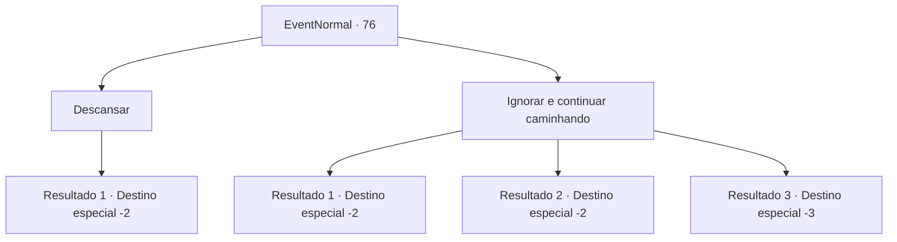

# Eventos normais · 76

[Índice da tabela](index.md) · [Índice geral](../index.md)

ID: `pt:EventNormal:76` · Fonte: `EventNormal4` · Versão: 1.2.47.

Mapeamento estático dos arquivos; a disponibilidade e a execução dependem do estado da run.

## Texto do evento

Começa a chover ao pôr do sol. Você entra na cidade para fazer uma verificação do equipamento, e então procura um lugar para descansar. Você encontra uma pousada chamada 'Silver Sturgeon'. |drawing_tavern| É uma franquia famosa com pelo menos uma pousada em cada cidade. Não há lugar melhor para descansar do que aqui.

## Dados de entrada

```json
{
  "id": 76,
  "grade": 1,
  "place": "",
  "required": ""
}
```

## Mapa das escolhas



## Escolhas e resultados

### Escolha 1

Descansar

Requisitos e outros campos da escolha:

```json
{
  "required": "1_4_10"
}
```

#### Resultado 1.1

Você entra na pousada. Você paga 10 ouros pela noite e descansa muito bem. Você continua sua jornada no dia seguinte com a mente clara.

Continuação registrada: [Destino especial `-2`](../destinos-especiais.md).

```json
{
  "required": "",
  "chance": "1",
  "nextEvent": -2,
  "type": 2,
  "reward": "0_0_1|0_1_1|0_4_-10|0_2_1"
}
```

### Escolha 2

Ignorar e continuar caminhando

Requisitos e outros campos da escolha:

```json
{
  "required": ""
}
```

#### Resultado 2.1

Você decide passar a pousada e se contenta com uma barraca. Você continua sua jornada no dia seguinte sentindo-se um pouco grogue.

Continuação registrada: [Destino especial `-2`](../destinos-especiais.md).

```json
{
  "required": "",
  "chance": "1",
  "nextEvent": -2,
  "type": 2,
  "reward": ""
}
```

#### Resultado 2.2

Você decide passar a pousada e se contenta com uma barraca. Quando você acorda, as gotas de chuva se transformaram em uma tempestade. Sua barraca explodiu e você tem que esperar no frio até que pare de chover.

Continuação registrada: [Destino especial `-2`](../destinos-especiais.md).

```json
{
  "required": "1_0_2",
  "chance": "1",
  "nextEvent": -2,
  "type": 2,
  "reward": "0_0_-1"
}
```

#### Resultado 2.3

Você decide passar a pousada e se contenta com uma barraca. Quando você acorda, as gotas de chuva se transformaram em uma tempestade. Sua barraca explodiu e você morre de hipotermia.

Continuação registrada: [Destino especial `-3`](../destinos-especiais.md).

```json
{
  "required": "2_0_2",
  "chance": "1",
  "nextEvent": -3,
  "type": 2,
  "reward": "0_0_-1"
}
```

## Referências que chegam a este evento

Nenhum `nextEvent` positivo da mesma tabela aponta para este nó. Isso não prova que seja inacessível: sorteio e estado de história podem selecioná-lo.

