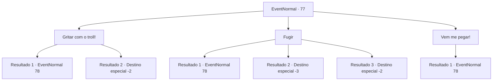

# Eventos normais · 77

[Índice da tabela](index.md) · [Índice geral](../index.md)

ID: `pt:EventNormal:77` · Fonte: `EventNormal4` · Versão: 1.2.47.

Mapeamento estático dos arquivos; a disponibilidade e a execução dependem do estado da run.

## Texto do evento

Você encontra as ruínas de uma cidade, indicadas apenas por uma placa quebrada. Conforme você entra com cuidado, um troll faminto se aproxima. Ele cheira você e começa a babar. 

 "Ruley com... fome... Você... carne... comida..."


## Dados de entrada

```json
{
  "id": 77,
  "grade": 1,
  "place": "",
  "required": "1_2_30|5_46_0"
}
```

## Mapa das escolhas



## Escolhas e resultados

### Escolha 1

Gritar com o troll!

Requisitos e outros campos da escolha:

```json
{
  "required": ""
}
```

#### Resultado 1.1

Você repreende o troll. Ele parece surpreso, mas depois fala. 

 "Comida... aqui... há muito tempo... Ruley... Famin-to..."

 Presumivelmente, ele destruiu a vila e comeu uma grande parte de sua população. E agora ele está vindo atrás de você.

Continuação registrada: [Evento 78](0078.md) na mesma tabela.

```json
{
  "required": "",
  "chance": "13",
  "nextEvent": 78,
  "type": 1,
  "reward": "6_0_9",
  "place": 13
}
```

#### Resultado 1.2

Você repreende o troll. Ele parece surpreso, mas depois fala. 

 "Comida... aqui... há muito tempo... Ruley... Famin-to..."

 Presumivelmente, ele destruiu a vila e comeu uma grande parte de sua população. Ele foge para a floresta, chorando.

Continuação registrada: [Destino especial `-2`](../destinos-especiais.md).

```json
{
  "required": "",
  "chance": "1|0_12_1",
  "nextEvent": -2,
  "type": 0,
  "reward": "0_2_1"
}
```

### Escolha 2

Fugir

Requisitos e outros campos da escolha:

```json
{
  "required": ""
}
```

#### Resultado 2.1

Você se afasta do troll e corre. Mas ele é mais rápido do que você pensava. Você sente que algo te atingiu com força nas costas. Você cai no chão e rola algumas vezes. O troll se aproxima de você quando você se levanta. Você não tem escolha a não ser lutar contra isso. 

Continuação registrada: [Evento 78](0078.md) na mesma tabela.

```json
{
  "required": "1_0_2",
  "chance": "10",
  "nextEvent": 78,
  "type": 1,
  "reward": "0_0_-1|6_0_9",
  "place": 13
}
```

#### Resultado 2.2

Você se afasta do troll e corre. Mas é mais rápido do que você pensava. Você sente que algo te atingiu com força nas costas. Você cai no chão e rola algumas vezes. Você perde a consciência.

Continuação registrada: [Destino especial `-3`](../destinos-especiais.md).

```json
{
  "required": "2_0_2",
  "chance": "7",
  "nextEvent": -3,
  "type": 1,
  "reward": "0_0_-1"
}
```

#### Resultado 2.3

Você se afasta do troll e corre. Ele está com muita fome e tenta te pegar.

Continuação registrada: [Destino especial `-2`](../destinos-especiais.md).

```json
{
  "required": "",
  "chance": "1|0_6_1",
  "nextEvent": -2,
  "type": 0,
  "reward": "0_2_1"
}
```

### Escolha 3

Vem me pegar!

Requisitos e outros campos da escolha:

```json
{
  "required": ""
}
```

#### Resultado 3.1

Você provoca o troll com seus gritos. Ele vem até você, os braços balançam.

Continuação registrada: [Evento 78](0078.md) na mesma tabela.

```json
{
  "required": "",
  "chance": "1",
  "nextEvent": 78,
  "type": 2,
  "reward": "6_0_9",
  "place": 13
}
```

## Referências que chegam a este evento

Nenhum `nextEvent` positivo da mesma tabela aponta para este nó. Isso não prova que seja inacessível: sorteio e estado de história podem selecioná-lo.

