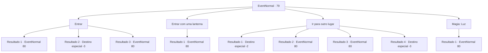

# Eventos normais · 79

[Índice da tabela](index.md) · [Índice geral](../index.md)

ID: `pt:EventNormal:79` · Fonte: `EventNormal4` · Versão: 1.2.47.

Mapeamento estático dos arquivos; a disponibilidade e a execução dependem do estado da run.

## Texto do evento

Você encontra um buraco que leva ao subsolo. Você espia e vê degraus de pedra no escuro. Parece ser uma entrada que leva a uma masmorra. 

## Dados de entrada

```json
{
  "id": 79,
  "grade": 1,
  "place": "",
  "required": ""
}
```

## Mapa das escolhas



## Escolhas e resultados

### Escolha 1

Entrar

Requisitos e outros campos da escolha:

```json
{
  "required": ""
}
```

#### Resultado 1.1

Você desce as escadas. Elas levam à escuridão, então você se move cautelosamente com as duas mãos contra a parede. De repente, algo zune em sua direção. Você não está preparado para desviar e, por causa de uma dor ardente no ombro, percebe que é uma flecha.

Continuação registrada: [Evento 80](0080.md) na mesma tabela.

```json
{
  "required": "1_0_2",
  "chance": "20",
  "nextEvent": 80,
  "type": 1,
  "reward": "0_0_-1|0_2_1|5_48_0|5_49_0"
}
```

#### Resultado 1.2

Você desce as escadas. Elas levam à escuridão, então você se move cautelosamente com as duas mãos contra a parede. De repente, algo zune em sua direção. Você não está preparado para desviar, e com uma dor ardente no ombro, o mundo desaparece.

Continuação registrada: [Destino especial `-3`](../destinos-especiais.md).

```json
{
  "required": "2_0_2",
  "chance": "20",
  "nextEvent": -3,
  "type": 1,
  "reward": "0_0_-1"
}
```

#### Resultado 1.3

Você desce as escadas. Elas levam à escuridão, então você se move cautelosamente com as duas mãos contra a parede. De repente, algo zune em sua direção. Você se esquiva graças aos seus incríveis reflexos.

Continuação registrada: [Evento 80](0080.md) na mesma tabela.

```json
{
  "required": "",
  "chance": "1|0_6_1",
  "nextEvent": 80,
  "type": 0,
  "reward": "0_2_1|5_48_0|5_49_0"
}
```

### Escolha 2

Entrar com uma lanterna

Requisitos e outros campos da escolha:

```json
{
  "required": "8_42_1"
}
```

#### Resultado 2.1

Você desce as escadas. Eles levam à escuridão, mas você tem sua lanterna. Você evita olhares suspeitos à medida que avança.

Continuação registrada: [Evento 80](0080.md) na mesma tabela.

```json
{
  "required": "",
  "chance": "1",
  "nextEvent": 80,
  "type": 2,
  "reward": "0_2_1|5_48_0|5_49_0"
}
```

### Escolha 3

Ir para outro lugar

Requisitos e outros campos da escolha:

```json
{
  "required": ""
}
```

#### Resultado 3.1

Você ignora a entrada e segue em frente.

Continuação registrada: [Destino especial `-2`](../destinos-especiais.md).

```json
{
  "required": "",
  "chance": "2",
  "nextEvent": -2,
  "type": 2,
  "reward": "0_2_1"
}
```

#### Resultado 3.2

Você ignora a entrada e tenta seguir em frente. Mas o chão cede depois de alguns passos, e você cai no subsolo. Você tem sorte de não ter se machucado.

Continuação registrada: [Evento 80](0080.md) na mesma tabela.

```json
{
  "required": "",
  "chance": "1",
  "nextEvent": 80,
  "type": 2,
  "reward": "0_2_1|5_48_0|5_49_0"
}
```

#### Resultado 3.3

Você ignora a entrada e tenta seguir em frente. Mas o chão cede depois de alguns passos, e você cai no subsolo. Você torceu o braço.

Continuação registrada: [Evento 80](0080.md) na mesma tabela.

```json
{
  "required": "1_0_2",
  "chance": "1",
  "nextEvent": 80,
  "type": 2,
  "reward": "0_0_-1|0_2_1|5_48_0|5_49_0"
}
```

#### Resultado 3.4

Você ignora a entrada e tenta seguir em frente. Mas o chão cede depois de alguns passos, e você cai no subsolo. Você cai de cabeça.

Continuação registrada: [Destino especial `-3`](../destinos-especiais.md).

```json
{
  "required": "2_0_2",
  "chance": "1",
  "nextEvent": -3,
  "type": 2,
  "reward": "0_0_-1"
}
```

### Escolha 4

Magia: Luz

Requisitos e outros campos da escolha:

```json
{
  "required": "20_0_1"
}
```

#### Resultado 4.1

Você desce as escadas. Elas levam à escuridão, mas você produziu um orbe brilhante para iluminar o caminho. Você se certifica de não pisar em ladrilhos suspeitos.

Continuação registrada: [Evento 80](0080.md) na mesma tabela.

```json
{
  "required": "",
  "chance": "1",
  "nextEvent": 80,
  "type": 2,
  "reward": "5_24_1|5_48_0|5_49_0"
}
```

## Referências que chegam a este evento

Nenhum `nextEvent` positivo da mesma tabela aponta para este nó. Isso não prova que seja inacessível: sorteio e estado de história podem selecioná-lo.

