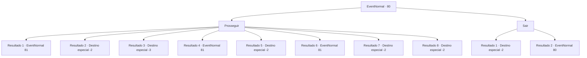

# Eventos normais · 80

[Índice da tabela](index.md) · [Índice geral](../index.md)

ID: `pt:EventNormal:80` · Fonte: `EventNormal4` · Versão: 1.2.47.

Mapeamento estático dos arquivos; a disponibilidade e a execução dependem do estado da run.

## Texto do evento

*Sem texto no arquivo.*

## Dados de entrada

```json
{
  "id": 80,
  "grade": 1,
  "place": "",
  "required": ""
}
```

## Mapa das escolhas



## Escolhas e resultados

### Escolha 1

Prosseguir

Requisitos e outros campos da escolha:

```json
{
  "required": ""
}
```

#### Resultado 1.1

Você consegue manter a calma. Seus olhos se ajustam ao escuro depois de algum tempo caminhando. Há ladrilhos suspeitosamente salientes, e você se certifica de não pisar em nenhum deles enquanto avança. Logo você está encharcado de suor e a masmorra chega ao fim. Na escuridão você vê um baú escuro e brilhante.

Continuação registrada: [Evento 81](0081.md) na mesma tabela.

```json
{
  "required": "10_42_1|18_24_1",
  "chance": "1",
  "nextEvent": 81,
  "type": 2,
  "reward": ""
}
```

#### Resultado 1.2

Você continua andando no escuro até não ter ideia de onde estava. Então você pisa em algo, e o rosto de alguém gritando aparece na sua frente. |drawing_scream| Você volta correndo, gritando, e chega ao lado de fora antes que perceba.

Continuação registrada: [Destino especial `-2`](../destinos-especiais.md).

```json
{
  "required": "1_1_2|10_42_1|18_24_1",
  "chance": "1",
  "nextEvent": -2,
  "type": 2,
  "reward": "0_1_-1"
}
```

#### Resultado 1.3

Você continua andando no escuro até não ter ideia de onde está. Então você pisa em algo, e o rosto de alguém gritando aparece na sua frente. |drawing_scream| Seu coração para de bater.

Continuação registrada: [Destino especial `-3`](../destinos-especiais.md).

```json
{
  "required": "2_1_2|10_42_1|18_24_1",
  "chance": "1",
  "nextEvent": -3,
  "type": 2,
  "reward": "0_1_-1"
}
```

#### Resultado 1.4

Você desce as escadas, com apenas a pequena lanterna para guiá-lo. Há ladrilhos suspeitosamente salientes, e você se certifica de não pisar em nenhum deles enquanto avança. Logo você está encharcado de suor e a masmorra chega ao fim. Na escuridão você vê um baú de bronze.

Continuação registrada: [Evento 81](0081.md) na mesma tabela.

```json
{
  "required": "8_42_1|18_24_1",
  "chance": "1|0_14_1",
  "nextEvent": 81,
  "type": 0,
  "reward": ""
}
```

#### Resultado 1.5

Você continua andando no escuro, com apenas a pequena lanterna para guiá-lo. Mas você não vê os ladrilhos salientes no chão e, quando cai, a lanterna quebra. A escuridão sopra ao seu redor. Você se sente ansioso e foge de lá.

Continuação registrada: [Destino especial `-2`](../destinos-especiais.md).

```json
{
  "required": "8_42_1|18_24_1",
  "chance": "13",
  "nextEvent": -2,
  "type": 1,
  "reward": "4_42_1|0_2_1"
}
```

#### Resultado 1.6

Você continua andando no escuro, com apenas uma pequena luz para guiá-lo. Há ladrilhos suspeitosamente salientes, e você se certifica de não pisar em nenhum deles enquanto avança. Logo você está encharcado de suor e a masmorra chega ao fim. Na escuridão você vê um baú de bronze.

Continuação registrada: [Evento 81](0081.md) na mesma tabela.

```json
{
  "required": "5_24_1",
  "chance": "1|0_14_1",
  "nextEvent": 81,
  "type": 0,
  "reward": "5_24_0"
}
```

#### Resultado 1.7

Você continua andando no escuro, com apenas uma pequena luz para guiá-lo. Então você pisa em algo, e o rosto de alguém gritando aparece na sua frente. |drawing_scream| Você corre de volta, gritando, e está do lado de fora antes que perceba.

Continuação registrada: [Destino especial `-2`](../destinos-especiais.md).

```json
{
  "required": "5_24_1|1_1_2",
  "chance": "13",
  "nextEvent": -2,
  "type": 1,
  "reward": "0_1_-1|5_24_0"
}
```

#### Resultado 1.8

Você continua andando no escuro, com apenas uma pequena luz para guiá-lo. Então você pisa em algo, e o rosto de alguém gritando aparece na sua frente. |drawing_scream| Seu coração para de bater.

Continuação registrada: [Destino especial `-2`](../destinos-especiais.md).

```json
{
  "required": "5_24_1|2_1_2",
  "chance": "13",
  "nextEvent": -2,
  "type": 1,
  "reward": "0_1_-1|5_24_0"
}
```

### Escolha 2

Sair

Requisitos e outros campos da escolha:

```json
{
  "required": "5_48_0"
}
```

#### Resultado 2.1

Você decide que é uma má ideia entrar, então escala a parede com facilidade para sair.

Continuação registrada: [Destino especial `-2`](../destinos-especiais.md).

```json
{
  "required": "",
  "chance": "1|0_5_1",
  "nextEvent": -2,
  "type": 0,
  "reward": "0_2_1"
}
```

#### Resultado 2.2

Você decide que foi uma má ideia entrar e tenta escalar a parede para sair. Mas é muito mais difícil subir o caminho que você desceu. Você se sente sobrecarregado, e então procura outro caminho.

Continuação registrada: [Evento 80](0080.md) na mesma tabela.

```json
{
  "required": "",
  "chance": "10",
  "nextEvent": 80,
  "type": 1,
  "reward": "5_48_1"
}
```

## Referências que chegam a este evento

- [Evento 79 · escolha 1 · resultado 1](0079.md#escolha-1)
- [Evento 79 · escolha 1 · resultado 3](0079.md#escolha-1)
- [Evento 79 · escolha 2 · resultado 1](0079.md#escolha-2)
- [Evento 79 · escolha 3 · resultado 2](0079.md#escolha-3)
- [Evento 79 · escolha 3 · resultado 3](0079.md#escolha-3)
- [Evento 79 · escolha 4 · resultado 1](0079.md#escolha-4)
- [Evento 80 · escolha 2 · resultado 2](0080.md#escolha-2)
