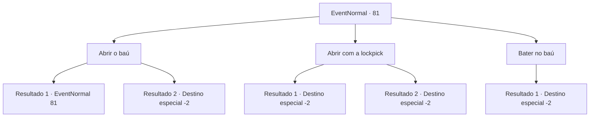

# Eventos normais · 81

[Índice da tabela](index.md) · [Índice geral](../index.md)

ID: `pt:EventNormal:81` · Fonte: `EventNormal4` · Versão: 1.2.47.

Mapeamento estático dos arquivos; a disponibilidade e a execução dependem do estado da run.

## Texto do evento

*Sem texto no arquivo.*

## Dados de entrada

```json
{
  "id": 81,
  "grade": 1,
  "place": "",
  "required": ""
}
```

## Mapa das escolhas



## Escolhas e resultados

### Escolha 1

Abrir o baú

Requisitos e outros campos da escolha:

```json
{
  "required": "5_49_0"
}
```

#### Resultado 1.1

Você tenta abrir o baú, mas ele não se move. Tem que haver outra maneira.

Continuação registrada: [Evento 81](0081.md) na mesma tabela.

```json
{
  "required": "",
  "chance": "11",
  "nextEvent": 81,
  "type": 1,
  "reward": "5_49_1"
}
```

#### Resultado 1.2

Você abre o baú com toda a sua força. O baú de bronze se dobra como borracha, revelando seu conteúdo. Dentro estão os pertences de um mago, e parecem caros. Você embala tudo e sai pela porta atrás do baú.

Continuação registrada: [Destino especial `-2`](../destinos-especiais.md).

```json
{
  "required": "",
  "chance": "1|0_5_1",
  "nextEvent": -2,
  "type": 0,
  "reward": "0_4_10|3_86_1|3_37_1|0_2_1"
}
```

### Escolha 2

Abrir com a lockpick

Requisitos e outros campos da escolha:

```json
{
  "required": "8_41_1"
}
```

#### Resultado 2.1

Você abre o baú usando uma gazua. Ela quebra, mas você consegue pegar o conteúdo do baú. Você sai pela porta atrás do baú logo depois.

Continuação registrada: [Destino especial `-2`](../destinos-especiais.md).

```json
{
  "required": "",
  "chance": "5",
  "nextEvent": -2,
  "type": 1,
  "reward": "0_4_10|4_41_1|3_37_1|3_86_1|0_2_1"
}
```

#### Resultado 2.2

Você abre o baú usando uma gazua. Dentro estão os pertences de um mago, e parecem caros. Você embala tudo e sai pela porta atrás do baú.

Continuação registrada: [Destino especial `-2`](../destinos-especiais.md).

```json
{
  "required": "",
  "chance": "1|0_6_1",
  "nextEvent": -2,
  "type": 0,
  "reward": "0_4_10|3_86_1|3_37_1|0_2_1"
}
```

### Escolha 3

Bater no baú

Requisitos e outros campos da escolha:

```json
{
  "required": ""
}
```

#### Resultado 3.1

Você pega sua arma para esmagar o baú de bronze. O bronze é um metal relativamente macio, então quebra facilmente, mas as garrafas dentro também. Você pega um manto embebido em líquido desconhecido e um pouco de ouro. E então você sai pela porta atrás do baú.

Continuação registrada: [Destino especial `-2`](../destinos-especiais.md).

```json
{
  "required": "",
  "chance": "1",
  "nextEvent": -2,
  "type": 2,
  "reward": "0_4_8|3_86_1|0_2_1"
}
```

## Referências que chegam a este evento

- [Evento 80 · escolha 1 · resultado 1](0080.md#escolha-1)
- [Evento 80 · escolha 1 · resultado 4](0080.md#escolha-1)
- [Evento 80 · escolha 1 · resultado 6](0080.md#escolha-1)
- [Evento 81 · escolha 1 · resultado 1](0081.md#escolha-1)
