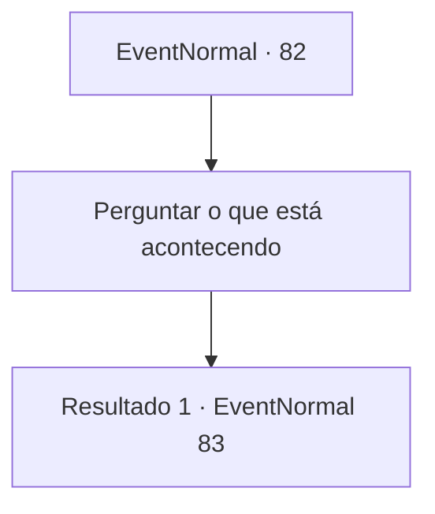

# Eventos normais · 82

[Índice da tabela](index.md) · [Índice geral](../index.md)

ID: `pt:EventNormal:82` · Fonte: `EventNormal4` · Versão: 1.2.47.

Mapeamento estático dos arquivos; a disponibilidade e a execução dependem do estado da run.

## Texto do evento

Você se depara com uma mulher enfrentando um homem de aparência agressiva. 

 "E-ei. Por favor me ajude!"

 Tremendo de medo, a aventureira pede sua ajuda. O homem range os dentes enquanto fala. 

 "Tem nada pra ver aqui. Continua andando."

 

## Dados de entrada

```json
{
  "id": 82,
  "grade": 1,
  "place": "",
  "required": "5_47_0"
}
```

## Mapa das escolhas



## Escolhas e resultados

### Escolha 1

Perguntar o que está acontecendo

Requisitos e outros campos da escolha:

```json
{
  "required": ""
}
```

#### Resultado 1.1

O homem rosna com sua pergunta. Então a mulher aterrorizada responde rapidamente. 

 "Ele... Ele é um vampiro! Ele está tentando sugar meu sangue!"

 Antes que ela possa terminar, o homem aperta seu colarinho. Seus olhos brilham vermelhos enquanto ele a encara. 

 "Como você ousa...!"


Continuação registrada: [Evento 83](0083.md) na mesma tabela.

```json
{
  "required": "",
  "chance": "1",
  "nextEvent": 83,
  "type": 2,
  "reward": ""
}
```

## Referências que chegam a este evento

Nenhum `nextEvent` positivo da mesma tabela aponta para este nó. Isso não prova que seja inacessível: sorteio e estado de história podem selecioná-lo.

