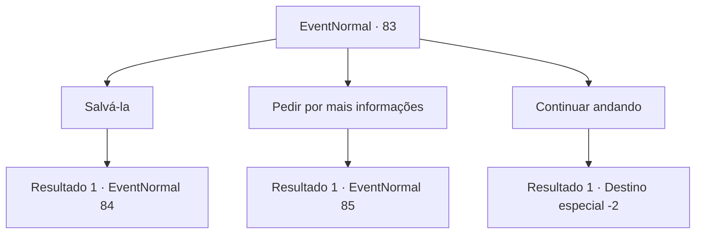

# Eventos normais · 83

[Índice da tabela](index.md) · [Índice geral](../index.md)

ID: `pt:EventNormal:83` · Fonte: `EventNormal4` · Versão: 1.2.47.

Mapeamento estático dos arquivos; a disponibilidade e a execução dependem do estado da run.

## Texto do evento

*Sem texto no arquivo.*

## Dados de entrada

```json
{
  "id": 83,
  "grade": 1,
  "place": "",
  "required": ""
}
```

## Mapa das escolhas



## Escolhas e resultados

### Escolha 1

Salvá-la

Requisitos e outros campos da escolha:

```json
{
  "required": ""
}
```

#### Resultado 1.1

Você decide cuidar do vampiro e salvar a aventureira. Você saca sua arma e o vampiro rosna, mostrando suas garras e presas.

Continuação registrada: [Evento 84](0084.md) na mesma tabela.

```json
{
  "required": "",
  "chance": "1",
  "nextEvent": 84,
  "type": 2,
  "reward": "6_0_122",
  "place": 4
}
```

### Escolha 2

Pedir por mais informações

Requisitos e outros campos da escolha:

```json
{
  "required": "1_14_12"
}
```

#### Resultado 2.1

Você vê a raiva e a frustração nos olhos do homem. Você pede a ele para lhe contar mais. Ele coloca a aventureira no chão. Ele diz: 

 "...Ela está meio certa. Eu sou um vampiro. Mas eu nunca tomei o sangue dela e nem pretendo. Só estou chateado que Lexie me traiu."

 Você acha que Lexie é o nome ou apelido de aventureiro. Lexie grita, envergonhada. 

 "N... não! Quantas vezes tenho que te dizer Rome! Ele é apenas um amigo de infância! Eu não tenho nenhum sentimento por ele! Nós bebemos e ficamos no mesmo quarto, mas nada aconteceu! Eu juro!"


Continuação registrada: [Evento 85](0085.md) na mesma tabela.

```json
{
  "required": "",
  "chance": "1",
  "nextEvent": 85,
  "type": 2,
  "reward": ""
}
```

### Escolha 3

Continuar andando

Requisitos e outros campos da escolha:

```json
{
  "required": ""
}
```

#### Resultado 3.1

Você ouve o homem e dá um passo no seu caminho. Eles estão ocupados discutindo uns com os outros.

Continuação registrada: [Destino especial `-2`](../destinos-especiais.md).

```json
{
  "required": "",
  "chance": "1",
  "nextEvent": -2,
  "type": 2,
  "reward": "5_47_9"
}
```

## Referências que chegam a este evento

- [Evento 82 · escolha 1 · resultado 1](0082.md#escolha-1)
